# DecompGym

DecompGym is an executable environment for testing whether coding agents can design and implement **decomposition algorithms**. Each task asks an agent to write a standalone `solver.py` that solves an optimization instance with **Benders decomposition** or **column generation**, using Gurobi. The environment runs the solver, checks its solution, has a second model audit whether the code really uses the requested method, and compares the objective with a reference.

The repository serves three purposes:

- **Learn Benders decomposition and column generation.** Nine problem families come with their formulations, a monolithic reference model and a decomposition reference that you can run and read: see [Problem formulations](#problem-formulations).
- **Benchmark coding agents.** Run any Codex, Claude Code or Antigravity model on the same 81 instances, under the same protocol as the paper.
- **Reproduce the paper.** Rebuild every table, figure and prompt example of the paper from the recorded experiments.

(The repository and its paths still use the earlier name, DecompBench.)

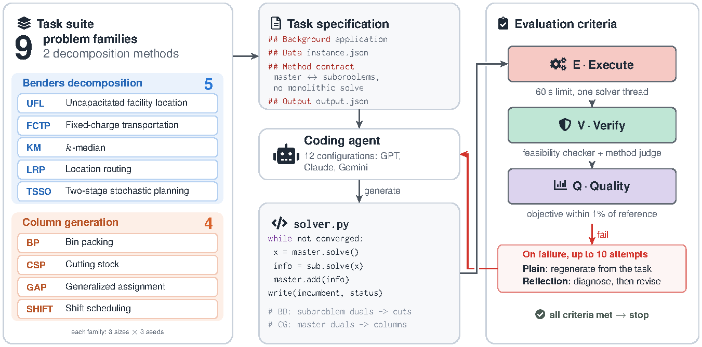

**Contents:** [Benchmark](#benchmark) · [Experimental setup](#experimental-setup) · [Results](#results) · [Quick start](#quick-start) · [Running a model](#running-a-model) · [Reproducing the paper](#reproducing-the-paper) · [Problem formulations](#problem-formulations) ([Benders](#benders-decomposition), [column generation](#column-generation)) · [Repository layout](#repository-layout) · [Citation](#citation) · [License](#license)

## Benchmark

| Method | Families |
| --- | --- |
| Benders decomposition (45 instances) | uncapacitated facility location (UFL), fixed-charge transportation (FCTP), k-median (KM), location routing (LRP), two-stage stochastic production (TSSO) |
| Column generation (36 instances) | bin packing (BP), cutting stock (CSP), generalized assignment (GAP), shift scheduling (SHIFT) |

Each family has three sizes × three seeds, so 81 fixed instances in [data/](data/README.md). Every task prompt includes the instance data, the output contract and a **method contract**: the solver must use the named decomposition, may not solve a separate monolithic model of the full problem, and may report `optimal` only with a proof of global optimality.

An attempt is scored by three criteria in order:

- **E — executable**: `solver.py` finishes within 60 seconds on one solver thread and writes a parseable `output.json`.
- **V — verified**: an independent checker confirms feasibility and recomputes the objective, and a **method judge** (GPT-6 Astra, high effort) reads the source and accepts that the decomposition is genuinely used.
- **Q — quality**: verified, and within 1% of the reference objective.

Q@k is the share of instances solved by at least one of the first k attempts. After a failed attempt, two policies continue from the same first attempt: **plain regeneration** (P) starts again from the task, and **reflection** (R) first asks the agent to diagnose the failure from the code, logs and judge notes, then revises. Each policy gets up to 10 attempts.

The paper evaluates 12 configurations, all at medium effort: five GPT models through Codex, six Claude models through Claude Code, and Gemini 3.8 Flash through Antigravity — 972 paired runs in total.

## Experimental setup

**Every agent call runs in a fresh Docker container.** An agent that runs on a developer's machine brings that machine with it: saved memories, user-level instructions and settings, installed skills and plugins, earlier conversations, and files left over from earlier attempts. Any of these can change what the agent writes, and none of them is part of the task. To compare models fairly and make runs repeatable, each generation, reflection and judge call starts a new container from the same pinned image (Codex 0.162.1, Claude Code 2.1.296, Antigravity 1.3.1) and is removed afterwards:

- the workspace is empty except for the one file to edit (`solver.py`, the reflection notes `debug.md`, or the judge's `alg_verifier.md`); all other context, such as the instance data, earlier code and logs, is pasted into the prompt;
- CLI memory, user-level configuration, plugins, skills and earlier sessions are disabled (Codex also runs without web search, and Claude Code is limited to its Read, Edit and Write tools), and each call is a new conversation;
- the container runs as an unprivileged user with all capabilities dropped, a seccomp profile, a read-only file system, one CPU and 1 GiB of memory; it keeps network access for the model API, and only the target file is copied back;
- the only state that persists between calls is the CLI login, stored in a private Docker volume per CLI.

**Solvers run natively, in a sandbox.** The generated `solver.py` runs on the host (macOS on Apple silicon, Python 3.12.11, Gurobi 11.0.3 with the host's license) inside a macOS Seatbelt sandbox with no network access, which can read only the instance data and the solver and write only to a private working directory. Each run is limited to 60 seconds and one solver thread.

**Protocol.** Each agent call may take up to 900 seconds. The method judge is GPT-6 Astra at high effort, called through Codex in the same container setup, and sees only the solver's source. Two instances run at a time, with at most two simultaneous Codex calls and one Claude Code or Antigravity call. A resource monitor pauses the run under sustained CPU, memory or thermal pressure; pauses are not counted in any reported time.

## Results

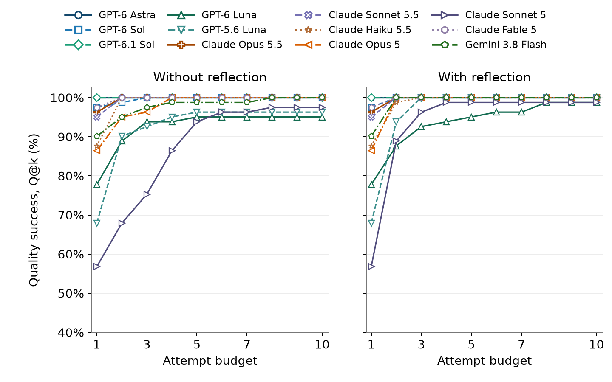

- 853 of 972 first attempts meet all three criteria. A single reflection retry solves 94 of the 119 failures, against 67 for plain regeneration.
- The method audit matters: 93 rejected attempts were feasible and within 1% of the reference, so a check of the output alone would have accepted them. Most of them report `optimal` without a proof; Claude Sonnet 5 accounts for 92 of the 96 such claims.

<details>
<summary><strong>Quality success Q@k per configuration</strong> (click to expand)</summary>

| Configuration | Q@1 | Q@2 P | Q@2 R | Q@10 P | Q@10 R |
| --- | ---: | ---: | ---: | ---: | ---: |
| GPT-6 Astra | 100.0% | 100.0% | 100.0% | 100.0% | 100.0% |
| GPT-6 Sol | 97.5% | 98.8% | 100.0% | 100.0% | 100.0% |
| GPT-6.1 Sol | 100.0% | 100.0% | 100.0% | 100.0% | 100.0% |
| GPT-6 Luna | 77.8% | 88.9% | 87.7% | 95.1% | 98.8% |
| GPT-5.6 Luna | 67.9% | 90.1% | 93.8% | 96.3% | 100.0% |
| Claude Opus 5.5 | 96.3% | 100.0% | 100.0% | 100.0% | 100.0% |
| Claude Sonnet 5.5 | 95.1% | 100.0% | 100.0% | 100.0% | 100.0% |
| Claude Haiku 5.5 | 87.7% | 100.0% | 98.8% | 100.0% | 100.0% |
| Claude Opus 5 | 86.4% | 95.1% | 100.0% | 100.0% | 100.0% |
| Claude Sonnet 5 | 56.8% | 67.9% | 88.9% | 97.5% | 98.8% |
| Claude Fable 5 | 97.5% | 100.0% | 100.0% | 100.0% | 100.0% |
| Gemini 3.8 Flash | 90.1% | 95.1% | 100.0% | 100.0% | 100.0% |
| **All 972 pairs** | **87.8%** | **94.7%** | **97.4%** | **99.1%** | **99.8%** |

</details>

All tables, figures and the prompt examples of the paper are in [results/](results/README.md). One complete trajectory, the paper's case study, is in [outputs/examples/](outputs/examples/claude_sonnet_5_csp_medium_seed000/README.md).

## Quick start

Requirements: macOS on Apple silicon (the solver sandbox uses `sandbox-exec`), Python 3.12.11 and Gurobi 11.0.3 with a license. Docker is needed only to run agents.

```bash
python3.12 -m venv .venv && source .venv/bin/activate
pip install -e ".[dev]"
python -m pytest -q                                   # unit tests; no model calls
python src/01_gen.py -s all -m validate -vl simple    # check the 81 instances and their references
```

The reference solvers can also be called from Python:

```python
from src.utils.api import solve, verify
result = solve("bd", "ufl", "data/bd/ufl/ufl_small_seed000/data.json")                       # Benders reference
print(verify("bd", "ufl", "data/bd/ufl/ufl_small_seed000/data.json", result["output"]))
```

## Running a model

```bash
docker build -f docker/agents/Dockerfile -t decompbench-agents-v2:20261013 .
python src/02_experiment.py docker prepare                        # check the image and record the runtime in outputs/runtime/
python src/02_experiment.py docker auth --backend codex --verify  # once per CLI: codex, claude or agy (see below)

python src/02_experiment.py init   --root outputs/experiments/my_run --config configs/paper.json
python src/02_experiment.py resume --root outputs/experiments/my_run      # a new campaign starts paused
python src/02_experiment.py watch  --root outputs/experiments/my_run --all-models
python src/02_experiment.py dashboard --root outputs/experiments/my_run   # http://localhost:8765
python src/03_analysis.py --campaign outputs/experiments/my_run           # audited report in outputs/reports/
```

`docker auth` stores a login in the CLI's private Docker volume and, with `--verify`, makes one unscored test edit that also runs in the solver sandbox:

- **Codex:** sign in on the host first (`codex login`); `auth` copies `~/.codex/auth.json`.
- **Claude Code:** create a subscription token with `claude setup-token` and paste it at the hidden prompt (or set `CLAUDE_CODE_OAUTH_TOKEN`).
- **Antigravity:** sign in once with `python src/02_experiment.py docker agy-login`. It asks you to choose a passphrase for a dedicated encrypted keyring, runs Antigravity's Google sign-in inside the agent image (open the URL, paste the code, then press Ctrl+C), and seals the login into the keyring volume. `docker agy-models` checks a saved login. Campaigns need the passphrase in `DECOMPBENCH_AGY_KEYRING_PASSPHRASE`.

To test other models, copy [configs/paper.json](configs/paper.json) and edit `model_queue`; the attempt budget, time limits, judge and prompts are fixed by the protocol. `init` freezes a copy of `src/`, `docker/`, the data and the config inside the campaign root, and `run`/`watch` only execute that copy, so later code changes never alter a running or finished campaign. `watch` restarts the run after infrastructure failures and pauses it under resource pressure.

## Reproducing the paper

The paper's two campaign folders (the original run and a four-model Claude extension, 1.8 GB) are not in the repository. With them in `outputs/experiments/`:

```bash
python src/03_analysis.py --refresh                     # audit the raw records and rebuild everything
python src/03_analysis.py --paper path/to/paper         # also compare with a paper folder
DECOMPBENCH_PAPER=path/to/paper python -m pytest tests/test_paper_equivalence.py
```

`03_analysis.py` writes all 12 tables, 12 figures and 8 prompt examples to `outputs/reports/paper/` and publishes them to [results/](results/README.md). Only the overview diagram (Figure 1) is a TikZ drawing, so rebuilding it needs `pdflatex`; without it, that figure is skipped and everything else is built. The equivalence tests check that this repository still matches the code that ran the paper: all 4,970 recorded generation, judge and reflection prompts are rebuilt byte for byte, all 2,363 executed solver outputs re-score identically, and every paper artifact is regenerated (text byte for byte, figures with identical rendering).

## Problem formulations

Each example uses the same reading order: **problem in words → symbols → original model → master problem → subproblem or pricing problem → cuts or columns → iteration and stopping rule**. A problem parameter is supplied in the instance; a decision variable is chosen by an optimization model. An LP, or linear program, allows continuous decisions, including fractions.

| Method | What the master decides | What the other problem does | What goes back to the master |
| --- | --- | --- | --- |
| **Benders decomposition** | Structural decisions, such as which facilities or arcs to open, and an estimate of the remaining cost. | A **subproblem** fixes those structural decisions and finds the best remaining decisions, or discovers infeasibility. | A **cut**: a new constraint that improves the cost estimate or excludes an infeasible choice. |
| **Column generation** | How much to use each currently available pattern, route, or shift. | A **pricing problem** uses the master's dual values to find a new useful pattern. | A **column**: a new decision variable, with its cost and coefficients in the master constraints. |

### Benders decomposition

<details>
<summary><strong>Benders · Uncapacitated facility location (UFL)</strong> — choose facilities, then assign customers</summary>

#### 1. Problem in words

We have candidate facilities and customers who need service. Opening a facility incurs a fixed cost, and assigning a customer to a facility incurs a service or shipping cost. We choose which facilities to open and how to serve every customer at minimum total cost. “Uncapacitated” means an open facility can serve any number of customers.

#### 2. Symbols: parameters and decision variables

| Symbol | Kind | Meaning |
| --- | --- | --- |
| $`i,j`$ | Indices | Candidate facility $`i`$ and customer $`j`$. |
| $`f_i`$ | Problem parameter | Fixed cost of opening facility $`i`$. |
| $`D_{ij}`$ | Problem parameter | Cost of serving customer $`j`$ from facility $`i`$. |
| $`y_i\in\{0,1\}`$ | Decision variable — master | 1 if facility $`i`$ opens. |
| $`x_{ij}\ge0`$ | Decision variable — subproblem | Fraction of customer $`j`$ assigned to facility $`i`$. |
| $`\theta_j\ge0`$ | Auxiliary decision variable — master | Lower estimate of customer $`j`$'s assignment cost. |
| $`\alpha_j`$ | Dual variable — subproblem | Unrestricted multiplier for serving customer $`j`$ completely. |
| $`\lambda_{ij}\le0`$ | Dual variable — subproblem | Multiplier for the constraint linking assignment to facility opening. |
| $`Q_j(\bar y)`$ | Derived value | Minimum assignment cost for customer $`j`$ when openings are fixed at $`\bar y`$. |

#### 3. Original optimization model

<div align="center">

$`\displaystyle \begin{aligned} \min_{y,x}\quad &\sum_i f_i y_i+\sum_{i,j}D_{ij}x_{ij}\\ \text{s.t.}\quad &\sum_i x_{ij}=1 &&\forall j\\ &x_{ij}\le y_i &&\forall i,j\\ &x_{ij}\ge0,\quad y_i\in\{0,1\}.& \end{aligned}`$

</div>

The first constraint serves every customer completely. The second permits service only from an open facility. For fixed binary openings, each customer can use its cheapest open facility, so allowing continuous assignments preserves the original integer assignment optimum.

#### 4. Master problem — choose facilities

The master chooses only $`y`$ and the assignment-cost estimates $`\theta`$. Actual assignments are handled by the subproblems.

<div align="center">

$`\displaystyle \begin{aligned} \min_{y,\theta}\quad &\sum_i f_i y_i+\sum_j\theta_j\\ \text{s.t.}\quad &\sum_i y_i\ge1\\ &y_i\in\{0,1\},\quad\theta_j\ge0\\ &\text{all Benders cuts added so far}.& \end{aligned}`$

</div>

The initial master knows opening costs but has little information about assignment costs. Requiring at least one open facility makes every customer subproblem feasible.

#### 5. Subproblem — assign one customer for fixed openings

After solving the master, fix its chosen openings at $`\bar y`$. Each customer $`j`$ solves an independent LP:

<div align="center">

$`\displaystyle Q_j(\bar y)=\min_{x}\left\{\sum_iD_{ij}x_i:\sum_i x_i=1,\ 0\le x_i\le\bar y_i\right\}.`$

</div>

Its dual is:

<div align="center">

$`\displaystyle Q_j(\bar y)=\max_{\alpha_j,\lambda}\left\{\alpha_j+\sum_i\lambda_{ij}\bar y_i:\alpha_j+\lambda_{ij}\le D_{ij},\ \lambda_{ij}\le0\right\}.`$

</div>

Here, $`\bar y`$ is an input to the subproblem, not a variable it can change.

#### 6. Cut returned to the master — a lower bound on assignment cost

An optimal dual solution gives the **optimality cut**:

<div align="center">

$`\displaystyle \theta_j\ge\alpha_j^\star+\sum_i\lambda_{ij}^\star y_i =Q_j(\bar y)+\sum_i\lambda_{ij}^\star(y_i-\bar y_i).`$

</div>

At the current openings, this cut makes $`\theta_j`$ at least the true assignment cost. At other openings, it remains a valid lower bound. The reference adds a separate cut for each customer whose cost is underestimated. Its opening guard makes feasibility cuts unnecessary.

#### 7. Iteration and stopping rule

Solve the master, solve all customer LPs, add violated cuts, and repeat. The master objective gives a lower bound; opening costs plus actual assignment costs give a feasible solution and an upper bound. When those bounds meet within tolerance, the facility-location solution is optimal.

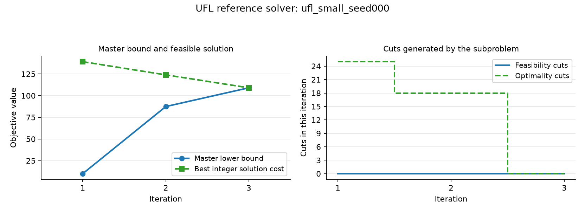

For the small, seed-000 reference, the bounds meet at approximately 109.114 after three iterations. The right panel counts the customer cuts generated in each iteration.

[Monolithic implementation](src/bd/ufl/b_gold_monolithic.py) · [Benders implementation](src/bd/ufl/b_gold_bd.py)

</details>

<details>
<summary><strong>Benders · Fixed-charge transportation (FCTP)</strong> — open arcs, then route shipment quantities</summary>

#### 1. Problem in words

Suppliers have limited supply, and demand nodes need shipments. Sending goods along an arc incurs a variable cost per unit; making that arc available also incurs a fixed charge. We choose which arcs to open and how much to ship on them. An open arc can still be insufficient because total supply and arc capacities must support all demand.

#### 2. Symbols: parameters and decision variables

| Symbol | Kind | Meaning |
| --- | --- | --- |
| $`i,j`$ | Indices | Supplier $`i`$ and demand node $`j`$. |
| $`s_i,d_j`$ | Problem parameters | Available supply and required demand. |
| $`u_{ij}`$ | Problem parameter | Maximum flow on arc $`(i,j)`$ when open. |
| $`f_{ij},c_{ij}`$ | Problem parameters | Fixed arc-opening cost and shipment cost per unit. |
| $`y_{ij}\in\{0,1\}`$ | Decision variable — master | 1 if transportation arc $`(i,j)`$ opens. |
| $`x_{ij}\ge0`$ | Decision variable — subproblem | Shipment quantity on arc $`(i,j)`$. |
| $`\theta\ge0`$ | Auxiliary decision variable — master | Lower estimate of total shipment cost; named $`z`$ in the code. |
| $`\pi_i\le0,\sigma_j\ge0,\mu_{ij}\le0`$ | Dual variables — subproblem | Multipliers for supply limits, demand requirements, and arc capacity links. |
| $`Q(\bar y)`$ | Derived value | Minimum shipment cost for fixed arc openings, when feasible. |

#### 3. Original optimization model

<div align="center">

$`\displaystyle \begin{aligned} \min_{y,x}\quad &\sum_{i,j}f_{ij}y_{ij}+\sum_{i,j}c_{ij}x_{ij}\\ \text{s.t.}\quad &\sum_jx_{ij}\le s_i &&\forall i\\ &\sum_ix_{ij}\ge d_j &&\forall j\\ &x_{ij}\le u_{ij}y_{ij} &&\forall i,j\\ &x_{ij}\ge0,\quad y_{ij}\in\{0,1\}.& \end{aligned}`$

</div>

The constraints limit supplier output, meet demand, and allow flow only on open arcs.

#### 4. Master problem — choose open transportation arcs

<div align="center">

$`\displaystyle \begin{aligned} \min_{y,\theta}\quad &\sum_{i,j}f_{ij}y_{ij}+\theta\\ \text{s.t.}\quad &\sum_i y_{ij}\ge1 &&\forall j\\ &y_{ij}\in\{0,1\},\quad\theta\ge0\\ &\text{all feasibility and optimality cuts added so far}.& \end{aligned}`$

</div>

All supplied instances have positive demand. Giving each demand node an open incoming arc is a useful initial guard, but it does not guarantee enough shipment capacity.

#### 5. Subproblem — ship goods over the fixed open arcs

<div align="center">

$`\displaystyle \begin{aligned} Q(\bar y)=\min_x\quad &\sum_{i,j}c_{ij}x_{ij}\\ \text{s.t.}\quad &\sum_jx_{ij}\le s_i &&\forall i\\ &\sum_ix_{ij}\ge d_j &&\forall j\\ &0\le x_{ij}\le u_{ij}\bar y_{ij} &&\forall i,j. \end{aligned}`$

</div>

This is a continuous transportation LP. If feasible, its dual is:

<div align="center">

$`\displaystyle \begin{aligned} \max_{\pi,\sigma,\mu}\quad &\sum_i s_i\pi_i+\sum_jd_j\sigma_j+\sum_{i,j}u_{ij}\bar y_{ij}\mu_{ij}\\ \text{s.t.}\quad &\pi_i+\sigma_j+\mu_{ij}\le c_{ij} &&\forall i,j\\ &\pi_i\le0,\quad\sigma_j\ge0,\quad\mu_{ij}\le0.& \end{aligned}`$

</div>

#### 6. Cuts returned to the master — cost information or a feasibility requirement

For feasible recourse, an optimal dual solution gives the **optimality cut**:

<div align="center">

$`\displaystyle \theta\ge\sum_i s_i\pi_i^\star+\sum_jd_j\sigma_j^\star+\sum_{i,j}u_{ij}\mu_{ij}^\star y_{ij}.`$

</div>

For infeasible recourse, an infeasibility ray uses the same signs and satisfies $`\hat\pi_i+\hat\sigma_j+\hat\mu_{ij}\le0`$. It gives the **feasibility cut**:

<div align="center">

$`\displaystyle \sum_i s_i\hat\pi_i+\sum_jd_j\hat\sigma_j+\sum_{i,j}u_{ij}\hat\mu_{ij}y_{ij}\le0.`$

</div>

The ray expression is positive at the current infeasible opening plan, so this new constraint excludes that plan. It also preserves every opening plan that permits feasible flow.

#### 7. Iteration and stopping rule

Choose arcs in the master, test shipment feasibility in the subproblem, and add the appropriate cut. Keep the cheapest feasible shipment plan as the incumbent. The master lower bound and incumbent upper bound meet when the fixed-charge transportation optimum is certified.

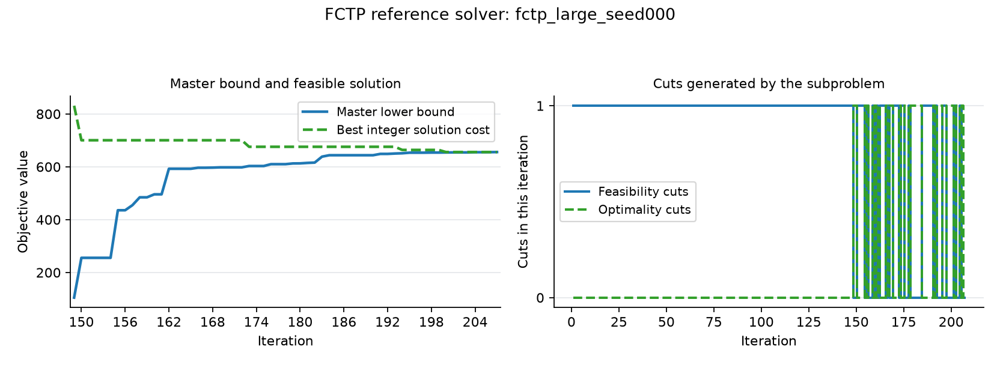

The large, seed-000 reference uses 207 iterations and converges at approximately 655.790. Many early iterations generate feasibility cuts before a feasible shipment plan is found; the left panel shows the phase with finite recorded bounds. The right panel separates feasibility cuts from optimality cuts.

[Monolithic implementation](src/bd/fctp/a_gold_monolithic.py) · [Benders implementation](src/bd/fctp/a_gold_bd.py)

</details>

<details>
<summary><strong>Benders · k-median (KM)</strong> — choose exactly k facilities, then assign customers</summary>

#### 1. Problem in words

We want to serve customers from exactly $`k`$ selected facility locations. The objective is to minimize total assignment cost, often interpreted as total travel distance. Unlike UFL, there is no opening-cost term: the number of selected locations is fixed. The decomposition separates location selection from customer assignment.

#### 2. Symbols: parameters and decision variables

| Symbol | Kind | Meaning |
| --- | --- | --- |
| $`i,j`$ | Indices | Candidate facility $`i`$ and customer $`j`$. |
| $`m,k`$ | Problem parameters | Number of candidates and required number of openings, with $`1\le k\le m`$. |
| $`D_{ij}`$ | Problem parameter | Cost or distance from facility $`i`$ to customer $`j`$. |
| $`y_i\in\{0,1\}`$ | Decision variable — master | 1 if location $`i`$ is selected. |
| $`x_{ij}\ge0`$ | Decision variable — subproblem | Fraction of customer $`j`$ assigned to facility $`i`$. |
| $`\theta\ge0`$ | Auxiliary decision variable — master | Lower estimate of total assignment cost; named $`z`$ in the code. |
| $`\alpha_j,\lambda_{ij}`$ | Dual variables — subproblem | Unrestricted assignment multipliers and nonpositive opening-link multipliers. |
| $`Q(\bar y)`$ | Derived value | Best assignment cost for the selected locations. |

#### 3. Original optimization model

<div align="center">

$`\displaystyle \begin{aligned} \min_{y,x}\quad &\sum_{i,j}D_{ij}x_{ij}\\ \text{s.t.}\quad &\sum_i y_i=k\\ &\sum_i x_{ij}=1 &&\forall j\\ &0\le x_{ij}\le y_i &&\forall i,j\\ &y_i\in\{0,1\}.& \end{aligned}`$

</div>

Facility-first indexing matches the stored matrix $`D_{ij}`$. Continuous assignment preserves the optimum because each customer can use a cheapest selected location.

#### 4. Master problem — select exactly k locations

<div align="center">

$`\displaystyle \begin{aligned} \min_{y,\theta}\quad &\theta\\ \text{s.t.}\quad &\sum_i y_i=k\\ &y_i\in\{0,1\},\quad\theta\ge0\\ &\text{all Benders optimality cuts added so far}.& \end{aligned}`$

</div>

The master initially knows how many locations to choose. Cuts teach it the assignment cost of those choices.

#### 5. Subproblem — assign all customers to the selected locations

<div align="center">

$`\displaystyle Q(\bar y)=\min_x\left\{\sum_{i,j}D_{ij}x_{ij}:\sum_i x_{ij}=1\ \forall j,\ 0\le x_{ij}\le\bar y_i\right\}.`$

</div>

The reference solves one assignment LP containing all customers. Its dual is:

<div align="center">

$`\displaystyle Q(\bar y)=\max_{\alpha,\lambda}\left\{\sum_j\alpha_j+\sum_{i,j}\lambda_{ij}\bar y_i:\alpha_j+\lambda_{ij}\le D_{ij},\ \lambda_{ij}\le0\right\}.`$

</div>

The equality multipliers $`\alpha_j`$ are unrestricted.

#### 6. Cut returned to the master — total assignment cost

<div align="center">

$`\displaystyle \theta\ge\sum_j\alpha_j^\star+\sum_{i,j}\lambda_{ij}^\star y_i.`$

</div>

This **optimality cut** bounds the aggregate assignment cost. Selecting $`k\ge1`$ locations always permits assignments in this uncapacitated family, so feasibility cuts are unnecessary.

#### 7. Iteration and stopping rule

Solve location selection, evaluate its assignment cost, add a violated cut, and repeat. The master value is the lower bound and the best actual assignment cost is the upper bound. Matching bounds certify the k-median optimum.

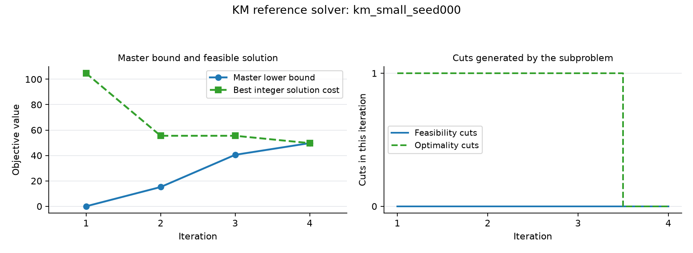

The small, seed-000 reference closes its bound gap after four iterations, at approximately 49.712.

[Monolithic implementation](src/bd/km/a_gold_monolithic.py) · [Benders implementation](src/bd/km/a_gold_bd.py)

</details>

<details>
<summary><strong>Benders · Location routing (LRP)</strong> — open depots, then choose from supplied routes</summary>

#### 1. Problem in words

We have candidate depots and a supplied collection of feasible delivery routes. Each route starts at a particular depot, visits some customers, and has a known cost. We choose depots and routes so every customer is served exactly once and depot fleet limits are respected. This example optimizes over the supplied routes; route construction is already encoded in that input.

#### 2. Symbols: parameters and decision variables

| Symbol | Kind | Meaning |
| --- | --- | --- |
| $`i,j,r`$ | Indices | Customer $`i`$, candidate depot $`j`$, and supplied route $`r`$. |
| $`R`$ | Problem parameter — set | Supplied feasible routes. |
| $`a_{ir}\in\{0,1\}`$ | Problem parameter | 1 if route $`r`$ visits customer $`i`$. |
| $`j(r),c_r`$ | Problem parameters | Route $`r`$'s depot and cost. |
| $`f_j,M_j`$ | Problem parameters | Depot-opening cost and maximum number of selected routes at depot $`j`$. |
| $`y_j\in\{0,1\}`$ | Decision variable — master | 1 if depot $`j`$ opens. |
| $`\lambda_r`$ | Decision variable — routing subproblem | Route usage: binary in the original model and integer evaluation, continuous in the cut-generating LP. |
| $`\theta\ge0`$ | Auxiliary decision variable — master | Lower estimate of routing cost from the LP relaxation; named $`z`$ in the code. |
| $`\alpha_i,\beta_j`$ | Dual variables — LP subproblem | Unrestricted customer-coverage multipliers and nonpositive fleet-limit multipliers. |
| $`Q_{\mathrm{LP}},Q_{\mathrm{IP}}`$ | Derived values | Best continuous and binary routing costs for fixed depot openings, when feasible. |

#### 3. Original optimization model

<div align="center">

$`\displaystyle \begin{aligned} \min_{y,\lambda}\quad &\sum_jf_jy_j+\sum_{r\in R}c_r\lambda_r\\ \text{s.t.}\quad &\sum_{r\in R}a_{ir}\lambda_r=1 &&\forall i\\ &\sum_{r:j(r)=j}\lambda_r\le M_jy_j &&\forall j\\ &\sum_jy_j\ge1\\ &y_j,\lambda_r\in\{0,1\}.& \end{aligned}`$

</div>

An open depot can dispatch at most $`M_j`$ routes. Coverage equalities ensure each customer belongs to exactly one selected route.

#### 4. Master problem — choose depots

<div align="center">

$`\displaystyle \begin{aligned} \min_{y,\theta}\quad &\sum_jf_jy_j+\theta\\ \text{s.t.}\quad &\sum_jy_j\ge1\\ &y_j\in\{0,1\},\quad\theta\ge0\\ &\text{all LP feasibility and optimality cuts added so far}.& \end{aligned}`$

</div>

Opening a depot is necessary but may not make routing feasible, because the supplied routes and fleet limits must jointly cover all customers.

#### 5. Subproblem — evaluate routing with the depot choices fixed

The LP used to generate cuts is:

<div align="center">

$`\displaystyle Q_{\mathrm{LP}}(\bar y)=\min_{\lambda\ge0}\left\{\sum_rc_r\lambda_r:\sum_ra_{ir}\lambda_r=1\ \forall i,\ \sum_{r:j(r)=j}\lambda_r\le M_j\bar y_j\ \forall j\right\}.`$

</div>

Its dual is:

<div align="center">

$`\displaystyle Q_{\mathrm{LP}}(\bar y)=\max_{\alpha,\beta}\left\{\sum_i\alpha_i+\sum_jM_j\beta_j\bar y_j:\sum_i a_{ir}\alpha_i+\beta_{j(r)}\le c_r\ \forall r,\ \beta_j\le0\right\}.`$

</div>

The implementation also solves the routing model with $`\lambda_r\in\{0,1\}`$ at the same fixed openings. That separate integer evaluation supplies a feasible incumbent when binary routing is feasible.

#### 6. Cuts returned to the master — bounds from the routing LP

A feasible LP gives the **optimality cut**:

<div align="center">

$`\displaystyle \theta\ge\sum_i\alpha_i^\star+\sum_jM_j\beta_j^\star y_j.`$

</div>

An infeasible LP gives the **feasibility cut**:

<div align="center">

$`\displaystyle \sum_i\hat\alpha_i+\sum_jM_j\hat\beta_jy_j\le0,`$

</div>

where $`\hat\beta_j\le0`$ and $`\sum_i a_{ir}\hat\alpha_i+\hat\beta_{j(r)}\le0`$ for every supplied route. These cuts describe continuous routing recourse. Integer routing is evaluated separately; a depot plan can permit fractional routing while admitting no binary routing solution.

#### 7. Iteration and stopping rule

Repeat depot selection and LP cut generation, while keeping the best feasible binary route plan. Since $`Q_{\mathrm{LP}}(y)\le Q_{\mathrm{IP}}(y)`$ whenever integer recourse is feasible, the optimal master gives a lower bound and a feasible integer plan gives an upper bound. Exhausting LP cuts can leave those bounds apart. Matching valid bounds certifies the integer optimum over the supplied route set. If the bounds remain apart, any feasible integer plan found remains an incumbent with its remaining gap; a run that finds no integer plan has no certified feasible integer solution.

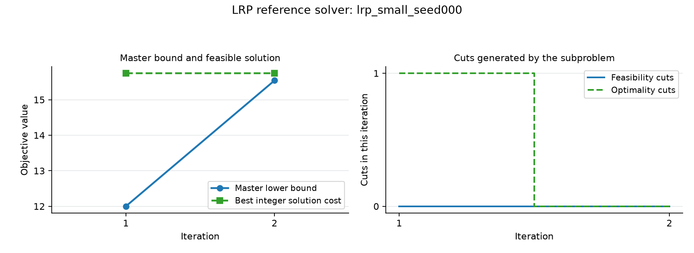

The small, seed-000 example stops after two iterations with lower bound approximately 15.541 and integer cost approximately 15.745. The visible gap illustrates the distinction between learning the LP routing cost and certifying the original integer problem.

[Monolithic implementation](src/bd/lrp/a_gold_monolithic.py) · [Benders implementation](src/bd/lrp/a_gold_bd.py)

</details>

<details>
<summary><strong>Benders · Two-stage stochastic production (TSSO)</strong> — activate capacity, then respond to demand scenarios</summary>

#### 1. Problem in words

A manufacturer must decide which regular production capacity to activate before demand is known. After a demand scenario is revealed, it can choose regular production, overtime, inventory, and backlog. The objective combines activation cost with expected operating cost across scenarios. The same activation plan must work for every scenario, while the operating decisions can differ by scenario.

#### 2. Symbols: parameters and decision variables

| Symbol | Kind | Meaning |
| --- | --- | --- |
| $`i,t,s`$ | Indices | Product $`i`$, period $`t=1,\ldots,T`$, and demand scenario $`s`$. |
| $`p_s`$ | Problem parameter | Scenario probability, with $`\sum_s p_s=1`$. |
| $`F_{it},K_{it}`$ | Problem parameters | Activation cost and available regular production capacity. |
| $`d_{its}`$ | Problem parameter | Demand for product $`i`$ in period $`t`$ under scenario $`s`$. |
| $`c^{\mathrm{reg}}_{it},c^{\mathrm{ot}}_{it},h_{it},b_{it}`$ | Problem parameters | Unit costs of regular production, overtime, inventory, and backlog. |
| $`I_{i0},B_{i0}`$ | Problem parameters | Initial inventory and backlog. |
| $`y_{it}\in\{0,1\}`$ | Decision variable — master | Activate regular capacity before the scenario is known. |
| $`r_{its},o_{its}\ge0`$ | Decision variables — scenario subproblem | Regular and overtime production. |
| $`I_{its},B_{its}\ge0`$ | Decision variables — scenario subproblem | End-of-period inventory and backlog. |
| $`\theta\ge0`$ | Auxiliary decision variable — master | Lower estimate of expected operating cost. |
| $`\mu_{its}\le0`$ | Dual variable — scenario subproblem | Multiplier on regular production capacity. |
| $`Q_s(\bar y),\alpha_s`$ | Derived values | Optimal scenario operating cost and intercept of its generated cost bound. |

#### 3. Original optimization model

<div align="center">

$`\displaystyle \begin{aligned} \min_{y,r,o,I,B}\quad &\sum_{i,t}F_{it}y_{it}+\sum_sp_s\sum_{i,t}\left(c^{\mathrm{reg}}_{it}r_{its}+c^{\mathrm{ot}}_{it}o_{its}+h_{it}I_{its}+b_{it}B_{its}\right)\\ \text{s.t.}\quad &I_{i,t-1,s}-B_{i,t-1,s}+r_{its}+o_{its}=d_{its}+I_{its}-B_{its} &&\forall i,t,s\\ &r_{its}\le K_{it}y_{it} &&\forall i,t,s\\ &y_{it}\in\{0,1\},\quad r_{its},o_{its},I_{its},B_{its}\ge0.& \end{aligned}`$

</div>

At period zero, use the supplied $`I_{i0}`$ and $`B_{i0}`$ for every scenario. The balance equation carries inventory or unmet demand from one period into the next.

#### 4. Master problem — activate regular capacity before demand is known

<div align="center">

$`\displaystyle \begin{aligned} \min_{y,\theta}\quad &\sum_{i,t}F_{it}y_{it}+\theta\\ \text{s.t.}\quad &y_{it}\in\{0,1\},\quad\theta\ge0\\ &\text{all expected-cost Benders cuts added so far}.& \end{aligned}`$

</div>

There is one shared activation plan $`y`$. Scenario-specific production plans belong to the subproblems.

#### 5. Subproblem — plan operations for one scenario

Fix $`y=\bar y`$ and solve a separate LP for each scenario $`s`$:

<div align="center">

$`\displaystyle \begin{aligned} Q_s(\bar y)=\min_{r,o,I,B}\quad &\sum_{i,t}\left(c^{\mathrm{reg}}_{it}r_{it}+c^{\mathrm{ot}}_{it}o_{it}+h_{it}I_{it}+b_{it}B_{it}\right)\\ \text{s.t.}\quad &I_{i,t-1}-B_{i,t-1}+r_{it}+o_{it}=d_{its}+I_{it}-B_{it} &&\forall i,t\\ &r_{it}\le K_{it}\bar y_{it},\quad r_{it},o_{it},I_{it},B_{it}\ge0.& \end{aligned}`$

</div>

Scenario subscripts on the operating decisions are suppressed here because this LP handles one scenario. Unlimited overtime and permitted terminal backlog make these subproblems feasible.

#### 6. Cut returned to the master — expected operating cost

For scenario $`s`$, the solved capacity multipliers give:

<div align="center">

$`\displaystyle \alpha_s=Q_s(\bar y)-\sum_{i,t}\mu_{its}^\star K_{it}\bar y_{it}.`$

</div>

The program combines those scenario bounds into one **optimality cut**:

<div align="center">

$`\displaystyle \theta\ge\sum_sp_s\left(\alpha_s+\sum_{i,t}\mu_{its}^\star K_{it}y_{it}\right).`$

</div>

The probabilities turn scenario operating costs into expected operating cost. This family uses only optimality cuts because recourse remains feasible for every activation plan.

#### 7. Iteration and stopping rule

Choose capacity, solve all scenario LPs, add a violated expected-cost cut, and repeat. Activation cost plus actual expected operating cost gives a feasible upper bound. When it meets the master lower bound, the two-stage stochastic optimum is certified. The reference stops once the relative gap between these bounds is at most 0.5%, or at the time budget, and returns its best complete incumbent; it reports `optimal` only when the bounds meet within numerical tolerance and `feasible` otherwise. Mathematical periods start at one here; Python arrays use zero-based period indices.

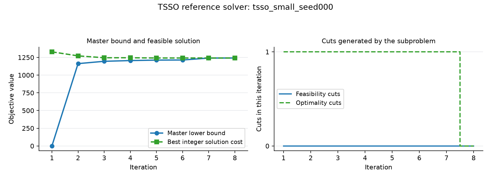

The small, seed-000 reference converges after eight iterations at approximately 1241.604. Each cut aggregates information from all scenarios.

[Monolithic implementation](src/bd/tsso/a_gold_monolithic.py) · [Benders implementation](src/bd/tsso/a_gold_bd.py)

</details>

### Column generation

<details>
<summary><strong>Column generation · Bin packing (BP)</strong> — choose packing patterns, then find a better pattern</summary>

#### 1. Problem in words

We must place all items into identical bins without exceeding each bin's capacity. The objective is to use as few bins as possible. The implementation groups equal-sized items into types and describes a bin by the number of items of each type it can hold. Column generation searches for useful bin patterns instead of listing every possible packing in advance.

#### 2. Symbols: parameters and decision variables

| Symbol | Kind | Meaning |
| --- | --- | --- |
| $`t,b,p`$ | Indices | Item type $`t`$, candidate bin $`b`$, and packing pattern $`p`$. |
| $`s_t,d_t`$ | Problem parameters | Size of type $`t`$ and number of actual items of that type. |
| $`C,B`$ | Problem parameters | Bin capacity and a sufficient candidate-bin bound $`B=\sum_t d_t`$. |
| $`y_b\in\{0,1\},q_{tb}\in\mathbb Z_{\ge0}`$ | Decision variables — original compact model | Use bin $`b`$ and place this many type-$`t`$ items in it. |
| $`P,P'`$ | Pattern sets | All feasible nonempty patterns and the patterns generated so far. |
| $`a_{tp}`$ | Column data | Number of type-$`t`$ slots in generated pattern $`p`$. |
| $`\lambda_p\ge0`$ | Decision variable — restricted master LP | Usage of pattern $`p`$, allowing fractions during column generation. |
| $`a_t\in\mathbb Z_{\ge0}`$ | Decision variable — pricing | Type-$`t`$ count in the new pattern being constructed. |
| $`\pi_t\ge0`$ | Dual variable — restricted master | Value associated with covering one more type-$`t`$ item. |
| $`\bar c(a)`$ | Derived value | Reduced cost of the candidate pattern. |

#### 3. Original optimization model

The implemented compact model uses type counts:

<div align="center">

$`\displaystyle \begin{aligned} \min_{y,q}\quad &\sum_{b=1}^{B}y_b\\ \text{s.t.}\quad &\sum_bq_{tb}\ge d_t &&\forall t\\ &\sum_t s_tq_{tb}\le Cy_b &&\forall b\\ &y_b\in\{0,1\},\quad q_{tb}\in\mathbb Z_{\ge0}.& \end{aligned}`$

</div>

Covering permits surplus type counts. Removing surplus slots and assigning the actual items preserves feasibility, so this model has the same optimal bin count as assigning every individual item exactly once.

#### 4. Master problem — use the available packing patterns

A pattern is feasible when $`\sum_t s_ta_{tp}\le C`$ and its counts are nonnegative integers. The **restricted master LP** uses only $`P'`$:

<div align="center">

$`\displaystyle \begin{aligned} \min_{\lambda\ge0}\quad &\sum_{p\in P'}\lambda_p\\ \text{s.t.}\quad &\sum_{p\in P'}a_{tp}\lambda_p\ge d_t &&\forall t. \end{aligned}`$

</div>

Each column represents one kind of bin and costs one unit. The initial columns are pure-type patterns: each bin is filled with as many copies of one type as fit. They make the initial master feasible.

#### 5. Pricing problem — construct a bin with negative reduced cost

The master supplies dual values $`\pi_t`$. Pricing solves an integer knapsack:

<div align="center">

$`\displaystyle \begin{aligned} \min_a\quad &\bar c(a)=1-\sum_t\pi_ta_t\\ \text{s.t.}\quad &\sum_t s_ta_t\le C\\ &\sum_t a_t\ge1,\quad a_t\in\mathbb Z_{\ge0}.& \end{aligned}`$

</div>

Equivalently, maximize $`\sum_t\pi_ta_t`$ and check whether it exceeds one. Counts can exceed the instance's type demand; bin capacity bounds them. This is the implemented unbounded type-knapsack pricing, rather than binary selection of individual item IDs. The best knapsack solution enters the master; the reference also keeps up to 64 alternative solutions from Gurobi's solution pool as additional columns for the final integer master.

#### 6. Column returned to the master — one new packing pattern

If $`\bar c(a^\star)<0`$, add $`a^\star`$ to $`P'`$ and introduce its usage variable $`\lambda_{\mathrm{new}}`$. Its objective coefficient is 1 and its coefficient in type-$`t`$ coverage is $`a_t^\star`$. Re-solve the master with this enlarged choice of bins.

#### 7. Iteration and stopping rule

Repeat master and pricing solves until complete pricing finds no negative reduced cost. This certifies the full type-pattern LP optimum. The implementation then solves the same master over generated patterns with integer usages $`\lambda_p\in\mathbb Z_{\ge0}`$ and maps its slots back to actual item IDs, trimming surplus. That produces a feasible integer packing. Full integer optimality follows when its cost matches a valid lower bound, including the ceiling of the completed LP bound because bin counts are integers; otherwise a gap can remain.

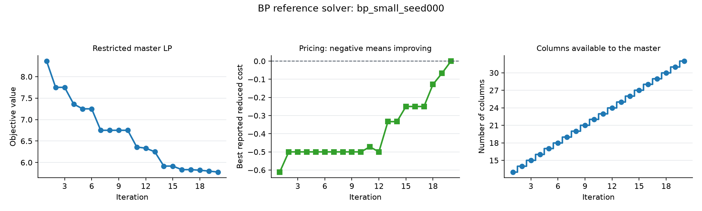

The small, seed-000 trace shows the master objective falling as new patterns become available. Negative reduced costs identify improving patterns; the final zero indicates completed pricing found no improving pattern within tolerance.

[Monolithic implementation](src/cg/bp/a_gold_monolithic.py) · [Column-generation implementation](src/cg/bp/a_gold_cg.py)

</details>

<details>
<summary><strong>Column generation · Cutting stock (CSP)</strong> — choose cutting patterns, then price a new pattern</summary>

#### 1. Problem in words

We have stock pieces of a fixed width and demands for smaller pieces of different widths. Each stock piece can be cut according to a feasible pattern. We want to meet all demands while using as few stock pieces as possible. A pattern can contain several pieces of the same type, and surplus production is permitted.

#### 2. Symbols: parameters and decision variables

| Symbol | Kind | Meaning |
| --- | --- | --- |
| $`i,b,p`$ | Indices | Required piece type $`i`$, candidate stock piece $`b`$, and cutting pattern $`p`$. |
| $`W,w_i,d_i`$ | Problem parameters | Stock width, type-$`i`$ piece width, and integer demand. |
| $`B=\sum_i d_i`$ | Problem parameter — chosen bound | Sufficient number of candidate stock pieces when each required width fits the stock. |
| $`y_b\in\{0,1\},q_{ib}\in\mathbb Z_{\ge0}`$ | Decision variables — original compact model | Use stock piece $`b`$ and cut this many type-$`i`$ pieces from it. |
| $`P,P'`$ | Pattern sets | All feasible nonempty cuts and the generated subset. |
| $`a_{ip}`$ | Column data | Number of type-$`i`$ pieces produced by pattern $`p`$. |
| $`\lambda_p\ge0`$ | Decision variable — restricted master LP | Usage of cutting pattern $`p`$. |
| $`a_i\in\mathbb Z_{\ge0}`$ | Decision variable — pricing | Count of type-$`i`$ pieces in a candidate pattern. |
| $`\pi_i\ge0`$ | Dual variable — restricted master | Value associated with covering type-$`i`$ demand. |
| $`\bar c(a)`$ | Derived value | Reduced cost of the candidate cutting pattern. |

#### 3. Original optimization model

<div align="center">

$`\displaystyle \begin{aligned} \min_{y,q}\quad &\sum_{b=1}^{B}y_b\\ \text{s.t.}\quad &\sum_iw_iq_{ib}\le Wy_b &&\forall b\\ &\sum_bq_{ib}\ge d_i &&\forall i\\ &y_b\in\{0,1\},\quad q_{ib}\in\mathbb Z_{\ge0}.& \end{aligned}`$

</div>

Every stock piece respects its width limit, and total production covers every demand.

#### 4. Master problem — choose among generated cutting patterns

Each pattern satisfies $`\sum_iw_i a_{ip}\le W`$. The **restricted master LP** is:

<div align="center">

$`\displaystyle \begin{aligned} \min_{\lambda\ge0}\quad &\sum_{p\in P'}\lambda_p\\ \text{s.t.}\quad &\sum_{p\in P'}a_{ip}\lambda_p\ge d_i &&\forall i. \end{aligned}`$

</div>

Start with pure-type patterns containing $`\lfloor W/w_i\rfloor`$ pieces of one type. These can cover every demand, so the initial LP is feasible.

#### 5. Pricing problem — find a more valuable use of one stock piece

<div align="center">

$`\displaystyle \begin{aligned} \min_a\quad &\bar c(a)=1-\sum_i\pi_i a_i\\ \text{s.t.}\quad &\sum_iw_i a_i\le W\\ &\sum_i a_i\ge1,\quad a_i\in\mathbb Z_{\ge0}.& \end{aligned}`$

</div>

The knapsack objective compares the cost of using one stock piece with the dual value of the pieces it produces. A dual value above one yields a negative reduced cost.

#### 6. Column returned to the master — one new cutting pattern

Add a negative-reduced-cost pattern $`a^\star`$ as a new master variable. It costs one stock piece and contributes $`a_i^\star`$ pieces to the type-$`i`$ demand constraint. The master can now combine that cut with the patterns already available.

#### 7. Iteration and stopping rule

Re-solve the master and price another pattern until complete pricing establishes the full cutting-pattern LP optimum. Then require integer pattern usage and solve the restricted integer master. This gives a feasible cutting plan over generated patterns. Matching a valid lower bound, potentially rounded up because stock counts are integers, certifies the full integer optimum; otherwise the generated-pattern solution can retain an integer gap.

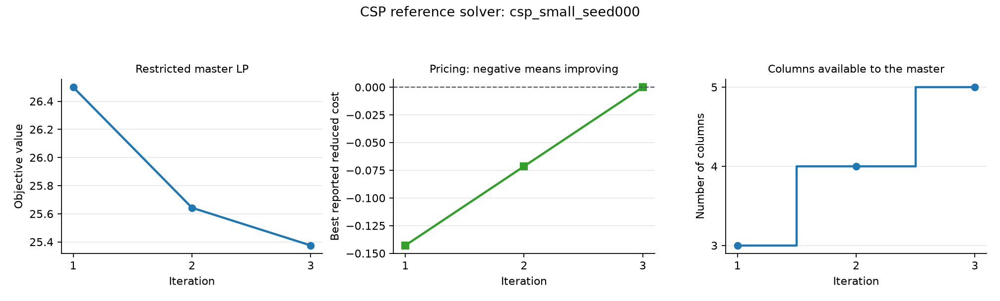

The small, seed-000 reference adds two patterns before pricing reaches zero. The master objective shown is the continuous pattern relaxation; the final integer plan is obtained afterward.

[Monolithic implementation](src/cg/csp/a_gold_monolithic.py) · [Column-generation implementation](src/cg/csp/a_gold_cg.py)

</details>

<details>
<summary><strong>Column generation · Generalized assignment (GAP)</strong> — combine machine assignments, then price a machine pattern</summary>

#### 1. Problem in words

Each job must be assigned to exactly one machine. Assigning a job consumes machine capacity and incurs a machine-specific cost. Instead of choosing every job-machine assignment directly, we describe a machine by a feasible subset of jobs it could handle. The master combines these machine patterns, while pricing searches for a better subset for one machine.

#### 2. Symbols: parameters and decision variables

| Symbol | Kind | Meaning |
| --- | --- | --- |
| $`i,j,p`$ | Indices | Job $`i`$, machine $`j`$, and machine-specific pattern $`p`$. |
| $`c_{ij},a_{ij},b_j`$ | Problem parameters | Assignment cost, resource consumption, and machine capacity. |
| $`x_{ij}\in\{0,1\}`$ | Decision variable — original compact model | Assign job $`i`$ to machine $`j`$. |
| $`P_j,P'_j`$ | Pattern sets | All feasible job subsets for machine $`j`$ and its generated subset. |
| $`z_{ijp}\in\{0,1\}`$ | Column data | 1 if machine-$`j`$ pattern $`p`$ includes job $`i`$. |
| $`c_{jp}=\sum_i c_{ij}z_{ijp}`$ | Column data | Cost of that machine pattern; an empty pattern costs zero. |
| $`\lambda_{jp}\ge0`$ | Decision variable — restricted master LP | Weight assigned to machine-$`j`$ pattern $`p`$. |
| $`z_i\in\{0,1\}`$ | Decision variable — machine pricing | Include job $`i`$ in the new pattern for the currently priced machine. |
| $`\pi_i,\sigma_j`$ | Dual variables — restricted master | Unrestricted multipliers for job coverage and machine pattern selection. |
| $`\bar c_j(z)`$ | Derived value | Reduced cost of a candidate pattern for machine $`j`$. |

#### 3. Original optimization model

<div align="center">

$`\displaystyle \begin{aligned} \min_x\quad &\sum_{i,j}c_{ij}x_{ij}\\ \text{s.t.}\quad &\sum_jx_{ij}=1 &&\forall i\\ &\sum_i a_{ij}x_{ij}\le b_j &&\forall j\\ &x_{ij}\in\{0,1\}.& \end{aligned}`$

</div>

Every job has one machine, and each machine respects its capacity.

#### 4. Master problem — combine feasible machine patterns

A pattern already satisfies $`\sum_i a_{ij}z_{ijp}\le b_j`$. The **restricted master LP** is:

<div align="center">

$`\displaystyle \begin{aligned} \min_{\lambda\ge0}\quad &\sum_j\sum_{p\in P'_j}c_{jp}\lambda_{jp}\\ \text{s.t.}\quad &\sum_j\sum_{p\in P'_j}z_{ijp}\lambda_{jp}=1 &&\forall i\\ &\sum_{p\in P'_j}\lambda_{jp}=1 &&\forall j. \end{aligned}`$

</div>

The second equality combines patterns into one plan per machine; it is called a convexity constraint. An empty pattern represents an idle machine. The implementation seeds empty and feasible single-job patterns. It then runs a phase-I restricted master with one artificial variable per job-coverage constraint, priced by the same machine knapsacks, until the artificial variables reach zero. No assignment model of the full problem is solved, including for initialization.

#### 5. Pricing problem — find a better subset of jobs for a machine

For each machine $`j`$, solve:

<div align="center">

$`\displaystyle \begin{aligned} \min_z\quad &\bar c_j(z)=\sum_i(c_{ij}-\pi_i)z_i-\sigma_j\\ \text{s.t.}\quad &\sum_i a_{ij}z_i\le b_j\\ &\sum_i z_i\ge1,\quad z_i\in\{0,1\}.& \end{aligned}`$

</div>

Both master constraint families are equalities, so their dual multipliers are unrestricted. Empty patterns are already present and cost zero; their dual constraints imply $`\sigma_j\le0`$ at an optimal master solution. Pricing searches only nonempty patterns and returns the most improving pattern found across machines.

#### 6. Column returned to the master — one feasible machine assignment

A negative-reduced-cost pattern creates a new variable $`\lambda_{j,\mathrm{new}}`$. Its cost is $`\sum_i c_{ij}z_i^\star`$, its coefficient in job-$`i`$ coverage is $`z_i^\star`$, and its coefficient in machine $`j`$'s convexity constraint is 1. Other machines' convexity coefficients are zero.

#### 7. Iteration and stopping rule

Repeat master and machine pricing solves until every machine's pricing is resolved and no improving pattern remains. This establishes the full machine-pattern LP optimum. A time-limited or otherwise unresolved pricing solve does not establish that certificate. The final restricted binary master chooses one generated pattern per machine, producing a feasible job assignment. A matching valid lower bound certifies the full integer optimum; otherwise an integer gap can remain.

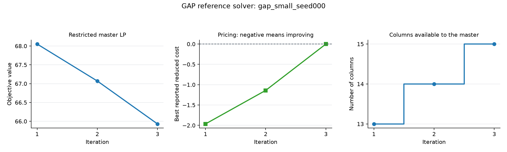

The small, seed-000 reference adds machine patterns until the reported reduced cost reaches zero. Each new column changes one machine's possible assignment while the master maintains global job coverage.

[Monolithic implementation](src/cg/gap/a_gold_monolithic.py) · [Column-generation implementation](src/cg/gap/a_gold_cg.py)

</details>

<details>
<summary><strong>Column generation · Shift scheduling</strong> — choose worker shifts, then price a time interval</summary>

#### 1. Problem in words

Each time slot needs a specified number of workers. A worker shift covers one consecutive interval of slots and must satisfy minimum and maximum length rules. We choose how many workers to assign to each legal shift so staffing meets demand. The implemented objective counts worker-shifts, with one unit of cost per worker on a shift.

#### 2. Symbols: parameters and decision variables

| Symbol | Kind | Meaning |
| --- | --- | --- |
| $`t=0,\ldots,T-1`$ | Index | Time slot, using the implementation's zero-based indexing. |
| $`d_t`$ | Problem parameter | Integer worker demand in slot $`t`$. |
| $`L_{\min},L_{\max}`$ | Problem parameters | Minimum and maximum legal shift lengths. |
| $`P,P'`$ | Pattern sets | All legal shift intervals and the generated subset. |
| $`p=[s_p,e_p]`$ | Column data | Start and inclusive end of a legal shift. |
| $`a_{tp}=\mathbb I(s_p\le t\le e_p)`$ | Column data | 1 when shift $`p`$ covers slot $`t`$; 0 otherwise. |
| $`x_p\in\mathbb Z_{\ge0}`$ | Decision variable — original and final integer master | Number of workers assigned to shift $`p`$. |
| $`\lambda_p\ge0`$ | Decision variable — restricted master LP | Continuous usage of shift $`p`$ during column generation. |
| $`s,e`$ | Decision choices — pricing | Start and end of a new legal shift. |
| $`\pi_t\ge0`$ | Dual variable — restricted master | Value associated with satisfying staffing demand in slot $`t`$. |
| $`\bar c(s,e)`$ | Derived value | Reduced cost of the candidate shift. |

#### 3. Original optimization model

<div align="center">

$`\displaystyle \begin{aligned} \min_{x}\quad &\sum_{p\in P}x_p\\ \text{s.t.}\quad &\sum_{p\in P}a_{tp}x_p\ge d_t &&\forall t\\ &x_p\in\mathbb Z_{\ge0},& \end{aligned}`$

</div>

where $`P`$ contains intervals with $`0\le s_p\le e_p<T`$ and $`L_{\min}\le e_p-s_p+1\le L_{\max}`$. Each unit of $`x_p`$ represents one worker assigned for that whole interval.

#### 4. Master problem — cover demand using available shifts

<div align="center">

$`\displaystyle \begin{aligned} \min_{\lambda\ge0}\quad &\sum_{p\in P'}\lambda_p\\ \text{s.t.}\quad &\sum_{p\in P'}a_{tp}\lambda_p\ge d_t &&\forall t. \end{aligned}`$

</div>

The initial set includes all legal minimum-length intervals, which together cover every slot when a legal shift fits the horizon. The master chooses how many copies of each available interval to use.

#### 5. Pricing problem — search for an improving interval

<div align="center">

$`\displaystyle \begin{aligned} \min_{s,e}\quad &\bar c(s,e)=1-\sum_{t=s}^{e}\pi_t\\ \text{s.t.}\quad &0\le s\le e<T\\ &L_{\min}\le e-s+1\le L_{\max},\quad s,e\in\mathbb Z.& \end{aligned}`$

</div>

The reference enumerates all legal intervals. A shift improves the current LP when the dual value of the slots it covers exceeds its unit cost.

#### 6. Column returned to the master — one legal shift

Add the improving interval $`[s^\star,e^\star]`$ as a new usage variable. It costs one unit and has coefficient 1 in every coverage constraint from $`s^\star`$ through $`e^\star`$, inclusive, and coefficient 0 elsewhere.

#### 7. Iteration and stopping rule

Repeat master and interval pricing solves until no improving legal interval remains. Complete pricing certifies the full shift-covering LP optimum. The program then solves the restricted master with integer worker counts. Compare that feasible schedule's cost with the completed LP bound: equality certifies integer optimality. The small, seed-000 example attains both values at 10 worker-shifts.

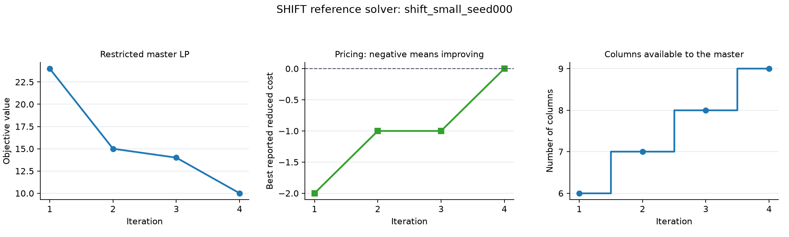

The trace shows four iterations. A negative reduced cost adds a shift; the final zero means no further interval improves the LP within tolerance. Shift endpoints in the JSON output are inclusive.

[Monolithic implementation](src/cg/shift/a_gold_monolithic.py) · [Column-generation implementation](src/cg/shift/a_gold_cg.py)

</details>

## Repository layout

```
src/
  01_gen.py           generate and validate the dataset              -> bd/, cg/, utils/
  02_experiment.py    Docker setup, campaigns, dashboard             -> experiments/
  03_analysis.py      every paper table and figure; campaign reports -> results/
  agent/              Docker CLI client, container runtime, all prompt text (prompts/)
  experiments/        campaign controller, paired runner, solver sandbox, verification, dashboard
  results/            audit snapshot, paper tables and figures, failure analysis, prompt examples
  bd/, cg/            the nine families: generator, task prompt, references, verifier
  utils/              base classes, dataset helpers, Python API, shared records
configs/paper.json    the paper's models and protocol
data/                 the 81 instances
docker/agents/        agent image, worker, Antigravity sign-in and seccomp profile
results/              published paper tables, figures and prompt examples
outputs/examples/     one complete example trajectory
assets/formulations/  charts used in the problem formulations
tests/                unit tests and paper-equivalence tests
```

## Citation

*Beyond Formulation: DecompGym, an Executable Environment for LLM Agents Designing Decomposition Algorithms* (paper forthcoming on arXiv).

## License

[MIT](LICENSE). Gurobi and the agent CLIs are external dependencies with their own license and service terms.
