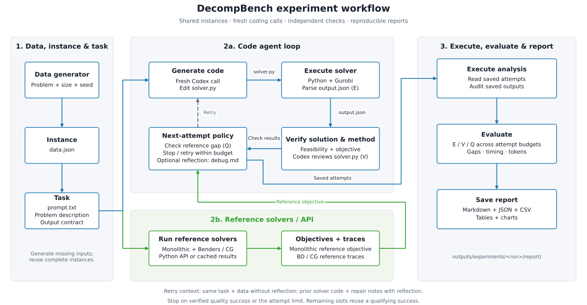
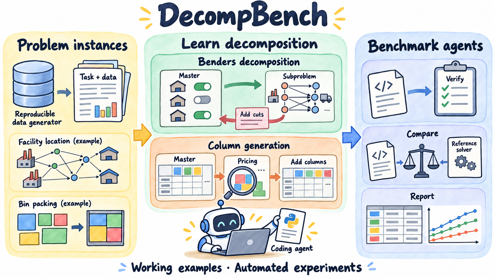
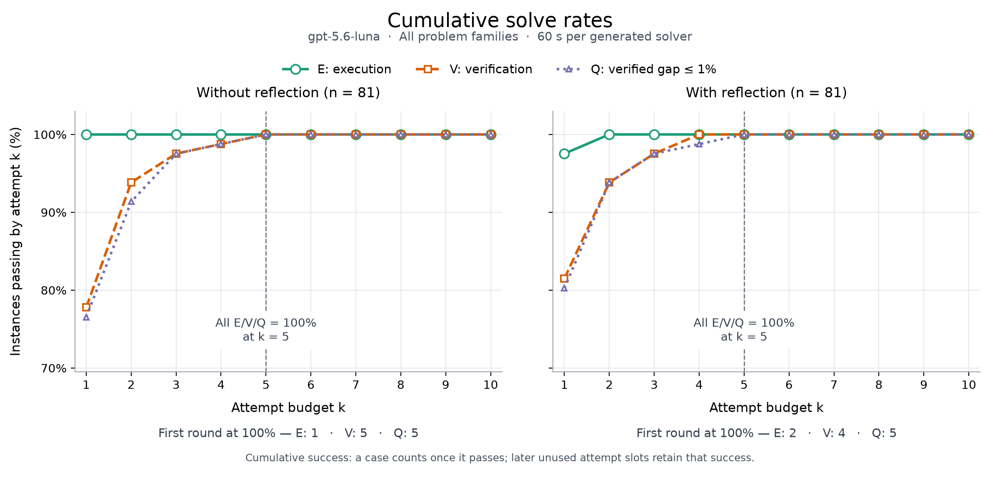
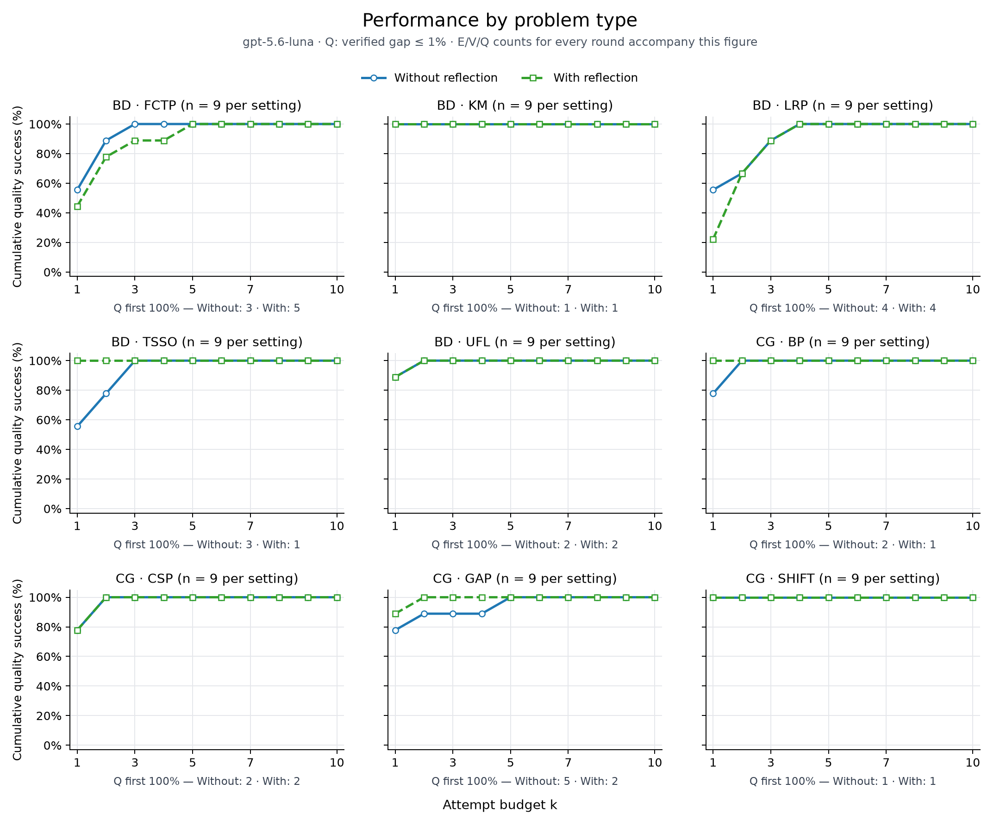
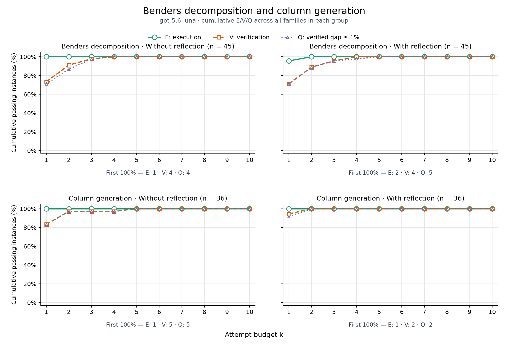
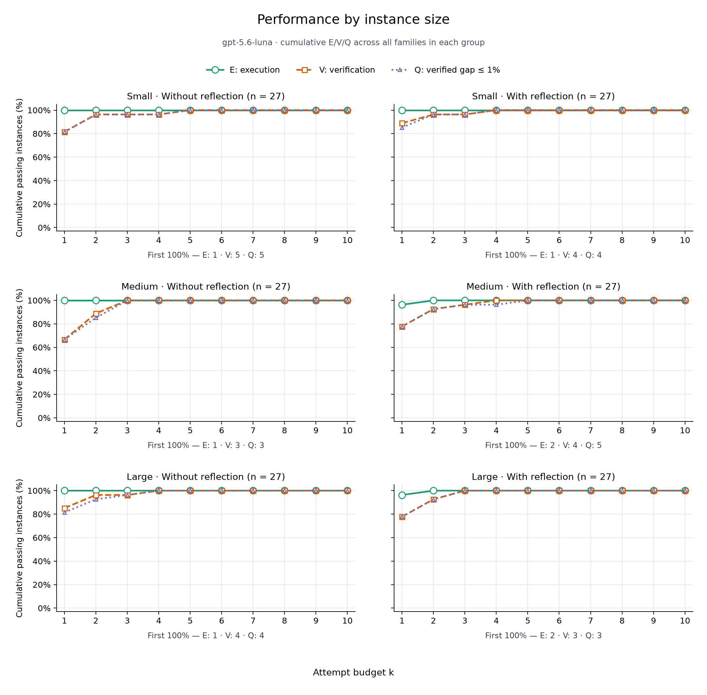

# DecompBench

We’re sharing DecompBench for two reasons. The first is to help people learn **Benders decomposition** and **column generation** from working code. When we looked for examples online, we found surprisingly few clear implementations, especially for Benders decomposition. Column generation has a few more, but good teaching examples are still hard to find. We hope the problem formulations and runnable implementations here help beginners in operations research and industrial engineering connect the math to the code.

The second is to share an example of how to benchmark coding agents on optimization tasks. Our starting point is [HeuriGym](https://github.com/cornell-zhang/heurigym) and its paper, [HeuriGym: An Agentic Benchmark for LLM-Crafted Heuristics in Combinatorial Optimization](https://arxiv.org/abs/2506.07972). We adapt its idea of generating code, running it, and using objective feedback to decomposition algorithms. We originally designed the tasks for GPT-4 and planned a benchmark paper, but agent capabilities moved quickly. We now share the examples and workflow as educational infrastructure. The [published GPT-5.6 Luna evaluation](#results) shows how execution, verification, solution quality, and retries behave across the supplied problems.

## What you can learn

You can use the repo to study the algorithms, try the examples yourself, or build your own agent benchmark:

- **Benders decomposition:** We provide instance generators, monolithic mixed-integer programming (MIP) models, and Benders solvers for five problem types: **uncapacitated facility location (UFL), fixed-charge transportation (FCTP), k-median (KM), location routing (LRP), and two-stage stochastic production (TSSO)**. Learn how the original MIP works, how the master and subproblems interact, and how cuts guide the solution. Every problem includes its formulation and runnable implementation. [Formulations](#benders-decomposition) · [Generators and solver implementations](src/bd/).
- **Column generation:** We provide instance generators, monolithic MIP models, and column-generation solvers for four problem types: **bin packing (BP), cutting stock (CSP), generalized assignment (GAP), and shift scheduling (SHIFT)**. Learn how the original MIP relates to the restricted master, how pricing discovers useful columns, and how those columns improve the master. Every problem includes its formulation and runnable implementation. [Formulations](#column-generation) · [Generators and solver implementations](src/cg/).
- **Benchmarking agents:** Follow the workflow from problem descriptions and generated code to execution, verification, and solution quality, then compare runs with and without reflection. [Agent experiments](#agent-experiments) · [EVQ evaluation](#evaluation) · [Agent harness](src/agent/).
- **GPT-5.6 Luna results:** Explore how many attempts the model needed across problem types, decomposition methods, and instance sizes, and inspect real trajectories. [Current results](#results) · [Example trajectories](#example-trajectories) · [Published result tables](results/luna_60s/).

## Repository layout

```text
DecompBench/
├── data/                         # Reusable instances and reference solutions
│   ├── bd/{ufl,fctp,km,lrp,tsso}/
│   └── cg/{bp,csp,gap,shift}/
├── src/
│   ├── api.py                    # generate_dataset(...) and solve(...)
│   ├── 01_gen.py                 # Generate missing instances; reuse existing data
│   ├── 02_exp_cli.py             # Codex experiment entry point
│   ├── 03_analysis.py            # Cumulative execution/verification/quality metrics
│   ├── 04_run_experiments.py     # With/without reflection, parallel jobs, and reuse
│   ├── 05_report.py              # Standalone reports and result charts
│   ├── bd/                       # Five Benders examples
│   ├── cg/                       # Four column-generation examples
│   ├── agent/
│   │   ├── codex_client.py       # Fresh CLI sessions and scoped file edits
│   │   ├── experiment_runner.py # Repeats, execution, feedback, and early stopping
│   │   ├── algorithm_verifier.py
│   │   ├── output_verifier.py
│   │   └── ...                  # Prompts, artifact management, and logs
│   └── utils/                    # Shared generator, solver, and iteration classes
├── assets/                       # Workflow, teaching figures, and published result charts
├── tests/                        # Optional developer checks
├── results/                      # Reference validation and selected Luna result tables
└── outputs/
    ├── examples/                 # Two curated experiment trajectories
    └── experiments/              # Your local experiments and reports; ignored
```

Each problem folder contains a data generator (`a_gen_data.py`), a business description and output contract (`b_problem.py`), monolithic and decomposition implementations (`*_gold_*.py`), a suite generator (`c_gen.py`), and a verifier (`d_verifier.py`). The shared classes in `src/utils/` expose the problem-specific hooks while keeping the iteration controller reusable.

## Quick start

The tested environment uses Python 3.12 and a working [Gurobi](https://www.gurobi.com/) 11 license.

```bash
python3.12 -m venv .venv
source .venv/bin/activate
pip install -e .
python -m src.01_gen
```

The default educational dataset is **9 instances per problem**: three seeds at each of `small`, `medium`, and `large`, for **81 instances total**. Sizes are relative to each generator and are intended to run locally. Complete existing instances are reused; missing or incomplete instances are generated. Explicitly pass `--regenerate` to rebuild them.

```bash
python -m src.01_gen --suite bd --problem ufl --sizes small --num-instances 1
python -m src.01_gen --mode validate --suite all
```

A data instance contains `data.json`, `prompt.txt`, `meta.json`, `gold_monolithic.json`, and `gold_bd.json` or `gold_cg.json`. The monolithic objective is the comparison reference. A decomposition result may have an integer gap; the separate reference files make that difference inspectable.

### Python API

```python
from src.api import generate_dataset, solve, verify

generate_dataset(suites=("bd",), sizes=("small",), num_instances=1)
path = "data/bd/ufl/ufl_small_seed000/data.json"
baseline = solve("bd", "ufl", path, method="monolithic")
benders = solve("bd", "ufl", path, method="decomposition")
print(baseline["best_objective"], benders["best_objective"])
print(benders["iter_records"])
print(verify("bd", "ufl", path, benders["output"]))
```

The return value is a JSON-compatible dictionary with the objective, bounds, iteration records, problem-specific solution metadata, and a normalized `output` accepted by `verify(...)`. Subclass `BaseBenders` or `BaseColumnGeneration` when adding a new formulation.

Column-generation results include `lp_converged`, which indicates that pricing found no improving column within `rc_tolerance`. If the loop stops earlier, `global_lb` is `None`; `global_ub` and `best_objective` still report the feasible integer solution. Incomplete pricing solves raise an error.

### Checking solutions

Call `verify(...)` to check constraints and decision domains, recompute the objective, and check that it matches the reported value. The experiment harness also reviews the requested decomposition method and compares the verified objective with the monolithic reference; see [EVQ evaluation](#evaluation).

### Agent experiments

Install the [Codex CLI](https://developers.openai.com/codex/cli), then authenticate with `codex login`. The harness uses your existing local authentication.

```bash
# Try an individual Benders instance without reflection.
python -m src.02_exp_cli --suite bd --problem ufl \
  --instance data/bd/ufl/ufl_small_seed000 --max-attempts 3

# Try the same instance with reflection after failed attempts.
python -m src.02_exp_cli --suite bd --problem ufl \
  --instance data/bd/ufl/ufl_small_seed000 --max-attempts 3 --reflection

# Run the full comparison: 81 instances × two settings = 162 runs.
python -m src.04_run_experiments --workers 2

# Save a standalone report; repository documentation is not modified.
python -m src.05_report
```

The two settings are **without reflection** and **with reflection**. Both start with the same problem description and instance. Without reflection, each retry receives that task and data again. With reflection, failed attempts produce concise repair notes, and the next fresh Codex call receives the prior solver code and notes as explicit context.

#### Sequential and concurrent runs

`--workers 2` runs up to two instance experiments concurrently. Attempts within one instance remain sequential. Use `--workers 1` for sequential experiments; use `--solver-threads` to control each solver. The default is one solver thread.

Use `--model` to choose a Codex model, `--instance` for one instance, and `--agent-timeout`/`--solver-timeout` for execution budgets. To run a smaller comparison, add `--suite bd --limit-per-problem 1 --max-attempts 3` to the sweep command.

The default execution deadline is 60 seconds for the entire generated `solver.py`, including its Benders or CG loop. Code generation, reflection and algorithm review have separate model-call deadlines. When changing the model or resource budgets, use a new `--output-root` to preserve the prior experiment's settings.

### Data → agent → evaluation



[Open the full-size flowchart](assets/workflow.svg) · [PNG version](assets/workflow.png)

The agent writes Benders or column-generation code from the task and data. The harness executes it, checks feasibility and the objective, reviews the requested algorithm, and compares the result with the monolithic reference. The same reference solvers are available directly through the Python API. The next-attempt policy controls whether feedback is included in the agent's context.

Each attempt saves its code, outputs, execution logs, prompts, CLI event traces, token usage, timing, and verifier decisions. A qualifying success stops further model calls; later attempt slots explicitly reuse that result.

<details>
<summary>Concept illustration</summary>



</details>

<details>
<summary>How an experiment runs, step by step</summary>

The left module prepares the instance and task. In the center, the upper module generates, executes, and verifies agent-written solvers, while the lower module supplies reference objectives and solver traces through the Python API or saved results. The right module runs analysis on saved attempts, audits their outputs, evaluates execution, verification, and quality, and exports reports. Generated solver execution happens inside the agent loop; the right-hand execution step runs the analysis and reporting code.

After setting up the Python environment, Gurobi license, dataset, and Codex CLI authentication, **run the Python experiment command**. The harness creates folders, assembles prompts, launches Codex, copies back edited files, executes the solver, and evaluates the result automatically. Each instance follows this order:

1. **Select the instance.** The runner receives an instance folder containing `data.json` and `prompt.txt`, either through `--instance` or by finding instances in the selected suite. It reads the reference objective from the original dataset for later comparison.
2. **Create the experiment folder and copy the inputs.** The program creates a folder for this instance under the experiment output root and copies `data.json` and `prompt.txt` into it. It creates an `attempts/` directory for the coding attempts. Reference solution files and `meta.json` stay in the original dataset and are omitted from the agent's supplied context.
3. **Prepare the first coding attempt.** The program creates `attempts/attempt_01/` and an empty `solver.py`. It assembles the generation prompt from the problem description and output contract in `prompt.txt`, a location note explaining where the solver will read and write files, instructions to implement a standalone solver with `gurobipy`, and the full contents of `data.json`. The solver must read `../../data.json` relative to its execution folder and write `output.json` in that folder. The complete prompt is saved as `agent_prompt.md`.
4. **Ask Codex to edit `solver.py`.** The client creates a temporary workspace outside the repository and stages only the target file there. It starts a fresh non-interactive `codex exec` call and sends the assembled prompt through standard input. Data and other context files are embedded as labeled text in the prompt; they are not copied into this temporary workspace. Codex is instructed to edit only `solver.py` and leave solver execution to the harness. The CLI uses `--ephemeral`, `--ignore-user-config`, and `--sandbox workspace-write`; project instructions and extra context features such as memories, plugins, hooks, and web search are disabled. Each subsequent review or reflection call uses another fresh workspace and session. See [Codex non-interactive execution](https://developers.openai.com/codex/noninteractive).
5. **Copy the edited file back.** Once the CLI exits successfully, reports a completed turn, and leaves a nonempty target file, the client copies `solver.py` into `attempts/attempt_01/`. Other files created by the agent in the temporary workspace are discarded when that workspace is removed. The harness separately saves the CLI events, final response, errors, timing, and token usage. An unsuccessful edit is recorded as an agent failure.
6. **Execute the generated solver locally.** Python launches `solver.py` in a separate process group using the experiment's Python interpreter, with `attempts/attempt_01/` as its working directory and the configured timeout and thread limits. This is when the solver reads the copied inputs and creates `output.json`. The runner removes any stale `output.json` before execution and checks that the process succeeds and produces a parseable JSON object. At the execution deadline, it terminates the process group, retains the available progress logs, and records `timeout`. Thread limits control parallelism; they do not impose an operating-system CPU percentage or memory quota.
7. **Check feasibility and the reported objective.** The program passes the copied instance and `output.json` to the independent verifier. It checks the solution's dimensions, decision domains, and problem constraints, then recomputes the objective from the decisions and compares it with the reported value. These checks inspect the proposed solution directly.
8. **Review the requested algorithm.** A second fresh Codex call receives the generated `solver.py` as embedded context and edits only `alg_verifier.md`. It reviews the master/subproblem or master/pricing split, use of duals or reduced costs, and iterative cut or column updates. The resulting `VERDICT: PASS` or `VERDICT: FAIL` and supporting notes are saved separately from the deterministic solution checks. This review runs after a successful generation call, including when solver execution fails, so its feedback can inform reflection.
9. **Score and save the attempt.** Verification requires both the independent solution checks and a passing algorithm review. The runner compares the verified objective with the original monolithic reference; a relative gap within the configured threshold, 1% by default, qualifies as success. It saves execution and verification feedback in `exec.log`, the attempt result in `summary.json`, and the accumulating instance history in `instance_summary.json`.
10. **Stop or prepare the next attempt.** A qualifying success stops further Codex calls for this instance; remaining attempt slots are marked `skipped_previous_solved` and reuse that success. For an unsuccessful attempt with reflection enabled, another fresh Codex call receives the task, data, current solver, available execution and review feedback, output, and objective gap, and edits only `debug.md` with repair notes. If another attempt remains, the next generation call edits a new `solver.py` with all prior solver files and repair notes included as explicit context. Without reflection, retries receive the task and data again. Coding attempts stop at `--max-attempts`.

The experiment folder keeps the inputs and attempt artifacts together. For example, the main files for one attempt are:

```text
<experiment-output>/ufl_small_seed000/
├── data.json                     # Copied instance
├── prompt.txt                    # Copied problem description and output contract
├── instance_summary.json         # History of actual attempts and reused slots
└── attempts/
    └── attempt_01/
        ├── agent_prompt.md       # Complete generation prompt, including data
        ├── agent_invocation.json # CLI configuration and target file
        ├── agent_events.jsonl    # Codex event trace
        ├── solver.py             # File copied back from the generation call
        ├── output.json           # Written when Python executes solver.py
        ├── llm_verifier_prompt.md
        ├── alg_verifier.md       # File copied back from the review call
        ├── exec.log              # Execution and verification feedback
        ├── summary.json          # Status, objective, gap, and step metrics
        └── debug.md              # Present when reflection is invoked
```

To inspect a trajectory from a sweep, open `outputs/experiments/<run>/<mode>/<suite>/<problem>/<instance>/attempts/attempt_01/`. Its `agent_prompt.md`, `solver.py`, `output.json`, `alg_verifier.md`, and `summary.json` record generation, execution, verification, and scoring. The instance's `instance_summary.json` records subsequent attempts and any reused success slots.

Users initiate experiments through Python after the initial CLI installation and login. Folder creation, prompt construction, file copying, solver execution, verification, and any retries or reflection are handled by the program. The temporary workspace and context settings control what the harness supplies to Codex; normal Codex sandbox permissions still apply.

</details>

### Your reports

Each run lives under `outputs/experiments/<run>/`; the default name is `default_run`. That folder contains the configuration, copied inputs, generated code, outputs, logs, and attempt summaries. Its `report/` subfolder contains `report.md`, `evaluation.json`, `evaluation.csv`, and result charts. The `outputs/` folder is ignored by Git. Only two curated teaching trajectories under `outputs/examples/` are included in Git. Other experiment directories remain ignored; selected published result tables live under `results/` and their figures under `assets/results/`.

To keep a named experiment and report:

```bash
python -m src.04_run_experiments --workers 2 \
  --output-root outputs/experiments/my_run
python -m src.05_report \
  --input-root outputs/experiments/my_run
```

The report destination defaults to `<input-root>/report`; use `--output` to choose another location. The reporter audits the selected experiment scope before producing a complete report. For an interim report, use `--allow-partial`; unfinished instances and interrupted backups are excluded from yield denominators. Reports include only attempt budgets covered by the experiment configuration.

## Evaluation

We use the staged **EVQ** metrics from the archived draft: **E** means **executable**, **V** means **validate**, and **Q** means **quality**. For instance $`n`$, attempt $`a`$, and budget $`k`$:

- $`E_{n,a}=1`$: the solver executes and produces a parseable output within the timeout.
- $`V_{n,a}=1`$: constraints and decision domains pass independent verification, the objective is recomputed consistently, and the algorithm review accepts the requested decomposition method.
- $`Q_{n,a}=1`$: verification passes and the relative gap to the monolithic reference is at most the configured threshold (default 1%).

```math
\mathrm{solve}S@k=\frac1N\sum_{n=1}^N\mathbb I\left(\max_{a\le k}S_{n,a}=1\right),\qquad S\in\{E,V,Q\}.
```

Report curves for every attempt budget $`k=1,\ldots,K`$, with summary tables at $`k\in\{1,5,10\}`$ when those budgets are available. Among verified attempts, $`\hat z_n^{(k)}=\min_{a\le k:V_{n,a}=1}z_{n,a}`$ and the minimization relative gap is:

```math
\mathrm{gap}_n^{(k)}=\frac{\hat z_n^{(k)}-z_n^\star}{\max\{1,|z_n^\star|\}}.
```

Quality statistics are conditional on verification and reported together with yield. Missing references or missing objectives remain unknown. The LLM algorithm review is recorded separately from deterministic feasibility so its evidence can be inspected.

For reference-solver bound traces, $`\Delta_t=(UB_t-LB_t)/\max\{1,|UB_t|\}`$ and the integrated gap is $`\sum_t\Delta_t(\tau_t-\tau_{t-1})`$, with normalized value obtained by dividing by total time. Bounds are certificates only when the underlying master and subproblem solves justify them.

### Results



- **Model:** `gpt-5.6-luna`, selected explicitly through Codex CLI. The published evaluation contains only this recorded model.
- **Coverage:** 81 instances per setting, 162 runs total. Each problem type has **N = 9**; Benders has **N = 45**, column generation **N = 36**, and each size **N = 27** per setting.
- **Budget:** ten attempt slots, 60 seconds per generated solver, one solver thread, and a 1% verified objective-gap threshold. Successful cases stop early.
- Both settings reach E/V/Q all at 100% by **round 5**. Without reflection reaches full E/V/Q at rounds **1 / 5 / 5**; with reflection at **2 / 4 / 5**.
- Without reflection used 110 coding attempts. With reflection used 105 coding attempts plus 24 reflection calls.
- Attempt one has no previous reflection in either setting. Its group differences reflect sampling; this single cohort does not establish a causal advantage for reflection.
- Read the [full result tables and protocol](results/luna_60s/README.md), [per-instance first passing rounds](results/luna_60s/instances.csv), or [exact grouped E/V/Q counts](results/luna_60s/attempt_breakdowns.csv).

<details>
<summary>Performance by problem type: table and quality curves</summary>

The percentage columns show cumulative E / V / Q after attempt 1. The first-100% columns show the round when every instance in that group first passed each metric.

| Group | N per setting | Without: E / V / Q @1 (%) | With: E / V / Q @1 (%) | Without: E / V / Q first 100% | With: E / V / Q first 100% |
| --- | ---: | --- | --- | --- | --- |
| BD · FCTP | 9 | 100.0 / 66.7 / 55.6 | 77.8 / 44.4 / 44.4 | 1 / 2 / 3 | 2 / 4 / 5 |
| BD · KM | 9 | 100.0 / 100.0 / 100.0 | 100.0 / 100.0 / 100.0 | 1 / 1 / 1 | 1 / 1 / 1 |
| BD · LRP | 9 | 100.0 / 55.6 / 55.6 | 100.0 / 22.2 / 22.2 | 1 / 4 / 4 | 1 / 4 / 4 |
| BD · TSSO | 9 | 100.0 / 55.6 / 55.6 | 100.0 / 100.0 / 100.0 | 1 / 3 / 3 | 1 / 1 / 1 |
| BD · UFL | 9 | 100.0 / 88.9 / 88.9 | 100.0 / 88.9 / 88.9 | 1 / 2 / 2 | 1 / 2 / 2 |
| CG · BP | 9 | 100.0 / 77.8 / 77.8 | 100.0 / 100.0 / 100.0 | 1 / 2 / 2 | 1 / 1 / 1 |
| CG · CSP | 9 | 100.0 / 77.8 / 77.8 | 100.0 / 88.9 / 77.8 | 1 / 2 / 2 | 1 / 2 / 2 |
| CG · GAP | 9 | 100.0 / 77.8 / 77.8 | 100.0 / 88.9 / 88.9 | 1 / 5 / 5 | 1 / 2 / 2 |
| CG · SHIFT | 9 | 100.0 / 100.0 / 100.0 | 100.0 / 100.0 / 100.0 | 1 / 1 / 1 | 1 / 1 / 1 |



This figure plots Q; the accompanying [CSV](results/luna_60s/attempt_breakdowns.csv) contains E, V, and Q for every round.

</details>

<details>
<summary>Benders decomposition and column generation: table and E/V/Q curves</summary>

| Group | N per setting | Without: E / V / Q @1 (%) | With: E / V / Q @1 (%) | Without: E / V / Q first 100% | With: E / V / Q first 100% |
| --- | ---: | --- | --- | --- | --- |
| Benders decomposition | 45 | 100.0 / 73.3 / 71.1 | 95.6 / 71.1 / 71.1 | 1 / 4 / 4 | 2 / 4 / 5 |
| Column generation | 36 | 100.0 / 83.3 / 83.3 | 100.0 / 94.4 / 91.7 | 1 / 5 / 5 | 1 / 2 / 2 |



</details>

<details>
<summary>Performance by instance size: small, medium, and large</summary>

Sizes are relative to each problem generator; each contains 27 instances per setting.

| Group | N per setting | Without: E / V / Q @1 (%) | With: E / V / Q @1 (%) | Without: E / V / Q first 100% | With: E / V / Q first 100% |
| --- | ---: | --- | --- | --- | --- |
| SMALL | 27 | 100.0 / 81.5 / 81.5 | 100.0 / 88.9 / 85.2 | 1 / 5 / 5 | 1 / 4 / 4 |
| MEDIUM | 27 | 100.0 / 66.7 / 66.7 | 96.3 / 77.8 / 77.8 | 1 / 3 / 3 | 2 / 4 / 5 |
| LARGE | 27 | 100.0 / 85.2 / 81.5 | 96.3 / 77.8 / 77.8 | 1 / 4 / 4 | 2 / 3 / 3 |



</details>

#### Example trajectories

- [Without reflection: one successful round](outputs/examples/without_reflection/README.md), on a small UFL instance.
- [With reflection: five rounds](outputs/examples/with_reflection/README.md), on a medium FCTP instance: early unusable objectives, a feasible solution outside the quality threshold, and then a solution matching the reference.
- Each example retains task and data, generation prompts, solver code, outputs, review decisions, summaries, and reflection notes when used. They illustrate two selected runs on different instances.

The [reference-solution validation](results/reference-validation.json) separately records checks of all supplied monolithic and decomposition solutions in `data/`.

## Problem formulations

Each example uses the same reading order: **problem in words → symbols → original model → master problem → subproblem or pricing problem → cuts or columns → iteration and stopping rule**. A problem parameter is supplied in the instance; a decision variable is chosen by an optimization model. An LP, or linear program, allows continuous decisions, including fractions.

| Method | What the master decides | What the other problem does | What goes back to the master |
| --- | --- | --- | --- |
| **Benders decomposition** | Structural decisions, such as which facilities or arcs to open, and an estimate of the remaining cost. | A **subproblem** fixes those structural decisions and finds the best remaining decisions, or discovers infeasibility. | A **cut**: a new constraint that improves the cost estimate or excludes an infeasible choice. |
| **Column generation** | How much to use each currently available pattern, route, or shift. | A **pricing problem** uses the master's dual values to find a new useful pattern. | A **column**: a new decision variable, with its cost and coefficients in the master constraints. |

### Benders decomposition

<details>
<summary><strong>Benders · Uncapacitated facility location (UFL)</strong> — choose facilities, then assign customers</summary>

#### 1. Problem in words

We have candidate facilities and customers who need service. Opening a facility incurs a fixed cost, and assigning a customer to a facility incurs a service or shipping cost. We choose which facilities to open and how to serve every customer at minimum total cost. “Uncapacitated” means an open facility can serve any number of customers.

#### 2. Symbols: parameters and decision variables

| Symbol | Kind | Meaning |
| --- | --- | --- |
| $`i,j`$ | Indices | Candidate facility $`i`$ and customer $`j`$. |
| $`f_i`$ | Problem parameter | Fixed cost of opening facility $`i`$. |
| $`D_{ij}`$ | Problem parameter | Cost of serving customer $`j`$ from facility $`i`$. |
| $`y_i\in\{0,1\}`$ | Decision variable — master | 1 if facility $`i`$ opens. |
| $`x_{ij}\ge0`$ | Decision variable — subproblem | Fraction of customer $`j`$ assigned to facility $`i`$. |
| $`\theta_j\ge0`$ | Auxiliary decision variable — master | Lower estimate of customer $`j`$'s assignment cost. |
| $`\alpha_j`$ | Dual variable — subproblem | Unrestricted multiplier for serving customer $`j`$ completely. |
| $`\lambda_{ij}\le0`$ | Dual variable — subproblem | Multiplier for the constraint linking assignment to facility opening. |
| $`Q_j(\bar y)`$ | Derived value | Minimum assignment cost for customer $`j`$ when openings are fixed at $`\bar y`$. |

#### 3. Original optimization model

<div align="center">

$`\displaystyle \begin{aligned} \min_{y,x}\quad &\sum_i f_i y_i+\sum_{i,j}D_{ij}x_{ij}\\ \text{s.t.}\quad &\sum_i x_{ij}=1 &&\forall j\\ &x_{ij}\le y_i &&\forall i,j\\ &x_{ij}\ge0,\quad y_i\in\{0,1\}.& \end{aligned}`$

</div>

The first constraint serves every customer completely. The second permits service only from an open facility. For fixed binary openings, each customer can use its cheapest open facility, so allowing continuous assignments preserves the original integer assignment optimum.

#### 4. Master problem — choose facilities

The master chooses only $`y`$ and the assignment-cost estimates $`\theta`$. Actual assignments are handled by the subproblems.

<div align="center">

$`\displaystyle \begin{aligned} \min_{y,\theta}\quad &\sum_i f_i y_i+\sum_j\theta_j\\ \text{s.t.}\quad &\sum_i y_i\ge1\\ &y_i\in\{0,1\},\quad\theta_j\ge0\\ &\text{all Benders cuts added so far}.& \end{aligned}`$

</div>

The initial master knows opening costs but has little information about assignment costs. Requiring at least one open facility makes every customer subproblem feasible.

#### 5. Subproblem — assign one customer for fixed openings

After solving the master, fix its chosen openings at $`\bar y`$. Each customer $`j`$ solves an independent LP:

<div align="center">

$`\displaystyle Q_j(\bar y)=\min_{x}\left\{\sum_iD_{ij}x_i:\sum_i x_i=1,\ 0\le x_i\le\bar y_i\right\}.`$

</div>

Its dual is:

<div align="center">

$`\displaystyle Q_j(\bar y)=\max_{\alpha_j,\lambda}\left\{\alpha_j+\sum_i\lambda_{ij}\bar y_i:\alpha_j+\lambda_{ij}\le D_{ij},\ \lambda_{ij}\le0\right\}.`$

</div>

Here, $`\bar y`$ is an input to the subproblem, not a variable it can change.

#### 6. Cut returned to the master — a lower bound on assignment cost

An optimal dual solution gives the **optimality cut**:

<div align="center">

$`\displaystyle \theta_j\ge\alpha_j^\star+\sum_i\lambda_{ij}^\star y_i =Q_j(\bar y)+\sum_i\lambda_{ij}^\star(y_i-\bar y_i).`$

</div>

At the current openings, this cut makes $`\theta_j`$ at least the true assignment cost. At other openings, it remains a valid lower bound. The reference adds a separate cut for each customer whose cost is underestimated. Its opening guard makes feasibility cuts unnecessary.

#### 7. Iteration and stopping rule

Solve the master, solve all customer LPs, add violated cuts, and repeat. The master objective gives a lower bound; opening costs plus actual assignment costs give a feasible solution and an upper bound. When those bounds meet within tolerance, the facility-location solution is optimal.


For the small, seed-000 reference, the bounds meet at approximately 109.114 after three iterations. The right panel counts the customer cuts generated in each iteration.

[Monolithic implementation](src/bd/ufl/b_gold_monolithic.py) · [Benders implementation](src/bd/ufl/b_gold_bd.py)

</details>

<details>
<summary><strong>Benders · Fixed-charge transportation (FCTP)</strong> — open arcs, then route shipment quantities</summary>

#### 1. Problem in words

Suppliers have limited supply, and demand nodes need shipments. Sending goods along an arc incurs a variable cost per unit; making that arc available also incurs a fixed charge. We choose which arcs to open and how much to ship on them. An open arc can still be insufficient because total supply and arc capacities must support all demand.

#### 2. Symbols: parameters and decision variables

| Symbol | Kind | Meaning |
| --- | --- | --- |
| $`i,j`$ | Indices | Supplier $`i`$ and demand node $`j`$. |
| $`s_i,d_j`$ | Problem parameters | Available supply and required demand. |
| $`u_{ij}`$ | Problem parameter | Maximum flow on arc $`(i,j)`$ when open. |
| $`f_{ij},c_{ij}`$ | Problem parameters | Fixed arc-opening cost and shipment cost per unit. |
| $`y_{ij}\in\{0,1\}`$ | Decision variable — master | 1 if transportation arc $`(i,j)`$ opens. |
| $`x_{ij}\ge0`$ | Decision variable — subproblem | Shipment quantity on arc $`(i,j)`$. |
| $`\theta\ge0`$ | Auxiliary decision variable — master | Lower estimate of total shipment cost; named $`z`$ in the code. |
| $`\pi_i\le0,\sigma_j\ge0,\mu_{ij}\le0`$ | Dual variables — subproblem | Multipliers for supply limits, demand requirements, and arc capacity links. |
| $`Q(\bar y)`$ | Derived value | Minimum shipment cost for fixed arc openings, when feasible. |

#### 3. Original optimization model

<div align="center">

$`\displaystyle \begin{aligned} \min_{y,x}\quad &\sum_{i,j}f_{ij}y_{ij}+\sum_{i,j}c_{ij}x_{ij}\\ \text{s.t.}\quad &\sum_jx_{ij}\le s_i &&\forall i\\ &\sum_ix_{ij}\ge d_j &&\forall j\\ &x_{ij}\le u_{ij}y_{ij} &&\forall i,j\\ &x_{ij}\ge0,\quad y_{ij}\in\{0,1\}.& \end{aligned}`$

</div>

The constraints limit supplier output, meet demand, and allow flow only on open arcs.

#### 4. Master problem — choose open transportation arcs

<div align="center">

$`\displaystyle \begin{aligned} \min_{y,\theta}\quad &\sum_{i,j}f_{ij}y_{ij}+\theta\\ \text{s.t.}\quad &\sum_i y_{ij}\ge1 &&\forall j\\ &y_{ij}\in\{0,1\},\quad\theta\ge0\\ &\text{all feasibility and optimality cuts added so far}.& \end{aligned}`$

</div>

All supplied instances have positive demand. Giving each demand node an open incoming arc is a useful initial guard, but it does not guarantee enough shipment capacity.

#### 5. Subproblem — ship goods over the fixed open arcs

<div align="center">

$`\displaystyle \begin{aligned} Q(\bar y)=\min_x\quad &\sum_{i,j}c_{ij}x_{ij}\\ \text{s.t.}\quad &\sum_jx_{ij}\le s_i &&\forall i\\ &\sum_ix_{ij}\ge d_j &&\forall j\\ &0\le x_{ij}\le u_{ij}\bar y_{ij} &&\forall i,j. \end{aligned}`$

</div>

This is a continuous transportation LP. If feasible, its dual is:

<div align="center">

$`\displaystyle \begin{aligned} \max_{\pi,\sigma,\mu}\quad &\sum_i s_i\pi_i+\sum_jd_j\sigma_j+\sum_{i,j}u_{ij}\bar y_{ij}\mu_{ij}\\ \text{s.t.}\quad &\pi_i+\sigma_j+\mu_{ij}\le c_{ij} &&\forall i,j\\ &\pi_i\le0,\quad\sigma_j\ge0,\quad\mu_{ij}\le0.& \end{aligned}`$

</div>

#### 6. Cuts returned to the master — cost information or a feasibility requirement

For feasible recourse, an optimal dual solution gives the **optimality cut**:

<div align="center">

$`\displaystyle \theta\ge\sum_i s_i\pi_i^\star+\sum_jd_j\sigma_j^\star+\sum_{i,j}u_{ij}\mu_{ij}^\star y_{ij}.`$

</div>

For infeasible recourse, an infeasibility ray uses the same signs and satisfies $`\hat\pi_i+\hat\sigma_j+\hat\mu_{ij}\le0`$. It gives the **feasibility cut**:

<div align="center">

$`\displaystyle \sum_i s_i\hat\pi_i+\sum_jd_j\hat\sigma_j+\sum_{i,j}u_{ij}\hat\mu_{ij}y_{ij}\le0.`$

</div>

The ray expression is positive at the current infeasible opening plan, so this new constraint excludes that plan. It also preserves every opening plan that permits feasible flow.

#### 7. Iteration and stopping rule

Choose arcs in the master, test shipment feasibility in the subproblem, and add the appropriate cut. Keep the cheapest feasible shipment plan as the incumbent. The master lower bound and incumbent upper bound meet when the fixed-charge transportation optimum is certified.


The large, seed-000 reference uses 207 iterations and converges at approximately 655.790. Many early iterations generate feasibility cuts before a feasible shipment plan is found; the left panel shows the phase with finite recorded bounds. The right panel separates feasibility cuts from optimality cuts.

[Monolithic implementation](src/bd/fctp/a_gold_monolithic.py) · [Benders implementation](src/bd/fctp/a_gold_bd.py)

</details>

<details>
<summary><strong>Benders · k-median (KM)</strong> — choose exactly k facilities, then assign customers</summary>

#### 1. Problem in words

We want to serve customers from exactly $`k`$ selected facility locations. The objective is to minimize total assignment cost, often interpreted as total travel distance. Unlike UFL, there is no opening-cost term: the number of selected locations is fixed. The decomposition separates location selection from customer assignment.

#### 2. Symbols: parameters and decision variables

| Symbol | Kind | Meaning |
| --- | --- | --- |
| $`i,j`$ | Indices | Candidate facility $`i`$ and customer $`j`$. |
| $`m,k`$ | Problem parameters | Number of candidates and required number of openings, with $`1\le k\le m`$. |
| $`D_{ij}`$ | Problem parameter | Cost or distance from facility $`i`$ to customer $`j`$. |
| $`y_i\in\{0,1\}`$ | Decision variable — master | 1 if location $`i`$ is selected. |
| $`x_{ij}\ge0`$ | Decision variable — subproblem | Fraction of customer $`j`$ assigned to facility $`i`$. |
| $`\theta\ge0`$ | Auxiliary decision variable — master | Lower estimate of total assignment cost; named $`z`$ in the code. |
| $`\alpha_j,\lambda_{ij}`$ | Dual variables — subproblem | Unrestricted assignment multipliers and nonpositive opening-link multipliers. |
| $`Q(\bar y)`$ | Derived value | Best assignment cost for the selected locations. |

#### 3. Original optimization model

<div align="center">

$`\displaystyle \begin{aligned} \min_{y,x}\quad &\sum_{i,j}D_{ij}x_{ij}\\ \text{s.t.}\quad &\sum_i y_i=k\\ &\sum_i x_{ij}=1 &&\forall j\\ &0\le x_{ij}\le y_i &&\forall i,j\\ &y_i\in\{0,1\}.& \end{aligned}`$

</div>

Facility-first indexing matches the stored matrix $`D_{ij}`$. Continuous assignment preserves the optimum because each customer can use a cheapest selected location.

#### 4. Master problem — select exactly k locations

<div align="center">

$`\displaystyle \begin{aligned} \min_{y,\theta}\quad &\theta\\ \text{s.t.}\quad &\sum_i y_i=k\\ &y_i\in\{0,1\},\quad\theta\ge0\\ &\text{all Benders optimality cuts added so far}.& \end{aligned}`$

</div>

The master initially knows how many locations to choose. Cuts teach it the assignment cost of those choices.

#### 5. Subproblem — assign all customers to the selected locations

<div align="center">

$`\displaystyle Q(\bar y)=\min_x\left\{\sum_{i,j}D_{ij}x_{ij}:\sum_i x_{ij}=1\ \forall j,\ 0\le x_{ij}\le\bar y_i\right\}.`$

</div>

The reference solves one assignment LP containing all customers. Its dual is:

<div align="center">

$`\displaystyle Q(\bar y)=\max_{\alpha,\lambda}\left\{\sum_j\alpha_j+\sum_{i,j}\lambda_{ij}\bar y_i:\alpha_j+\lambda_{ij}\le D_{ij},\ \lambda_{ij}\le0\right\}.`$

</div>

The equality multipliers $`\alpha_j`$ are unrestricted.

#### 6. Cut returned to the master — total assignment cost

<div align="center">

$`\displaystyle \theta\ge\sum_j\alpha_j^\star+\sum_{i,j}\lambda_{ij}^\star y_i.`$

</div>

This **optimality cut** bounds the aggregate assignment cost. Selecting $`k\ge1`$ locations always permits assignments in this uncapacitated family, so feasibility cuts are unnecessary.

#### 7. Iteration and stopping rule

Solve location selection, evaluate its assignment cost, add a violated cut, and repeat. The master value is the lower bound and the best actual assignment cost is the upper bound. Matching bounds certify the k-median optimum.


The small, seed-000 reference closes its bound gap after four iterations, at approximately 49.712.

[Monolithic implementation](src/bd/km/a_gold_monolithic.py) · [Benders implementation](src/bd/km/a_gold_bd.py)

</details>

<details>
<summary><strong>Benders · Location routing (LRP)</strong> — open depots, then choose from supplied routes</summary>

#### 1. Problem in words

We have candidate depots and a supplied collection of feasible delivery routes. Each route starts at a particular depot, visits some customers, and has a known cost. We choose depots and routes so every customer is served exactly once and depot fleet limits are respected. This example optimizes over the supplied routes; route construction is already encoded in that input.

#### 2. Symbols: parameters and decision variables

| Symbol | Kind | Meaning |
| --- | --- | --- |
| $`i,j,r`$ | Indices | Customer $`i`$, candidate depot $`j`$, and supplied route $`r`$. |
| $`R`$ | Problem parameter — set | Supplied feasible routes. |
| $`a_{ir}\in\{0,1\}`$ | Problem parameter | 1 if route $`r`$ visits customer $`i`$. |
| $`j(r),c_r`$ | Problem parameters | Route $`r`$'s depot and cost. |
| $`f_j,M_j`$ | Problem parameters | Depot-opening cost and maximum number of selected routes at depot $`j`$. |
| $`y_j\in\{0,1\}`$ | Decision variable — master | 1 if depot $`j`$ opens. |
| $`\lambda_r`$ | Decision variable — routing subproblem | Route usage: binary in the original model and integer evaluation, continuous in the cut-generating LP. |
| $`\theta\ge0`$ | Auxiliary decision variable — master | Lower estimate of routing cost from the LP relaxation; named $`z`$ in the code. |
| $`\alpha_i,\beta_j`$ | Dual variables — LP subproblem | Unrestricted customer-coverage multipliers and nonpositive fleet-limit multipliers. |
| $`Q_{\mathrm{LP}},Q_{\mathrm{IP}}`$ | Derived values | Best continuous and binary routing costs for fixed depot openings, when feasible. |

#### 3. Original optimization model

<div align="center">

$`\displaystyle \begin{aligned} \min_{y,\lambda}\quad &\sum_jf_jy_j+\sum_{r\in R}c_r\lambda_r\\ \text{s.t.}\quad &\sum_{r\in R}a_{ir}\lambda_r=1 &&\forall i\\ &\sum_{r:j(r)=j}\lambda_r\le M_jy_j &&\forall j\\ &\sum_jy_j\ge1\\ &y_j,\lambda_r\in\{0,1\}.& \end{aligned}`$

</div>

An open depot can dispatch at most $`M_j`$ routes. Coverage equalities ensure each customer belongs to exactly one selected route.

#### 4. Master problem — choose depots

<div align="center">

$`\displaystyle \begin{aligned} \min_{y,\theta}\quad &\sum_jf_jy_j+\theta\\ \text{s.t.}\quad &\sum_jy_j\ge1\\ &y_j\in\{0,1\},\quad\theta\ge0\\ &\text{all LP feasibility and optimality cuts added so far}.& \end{aligned}`$

</div>

Opening a depot is necessary but may not make routing feasible, because the supplied routes and fleet limits must jointly cover all customers.

#### 5. Subproblem — evaluate routing with the depot choices fixed

The LP used to generate cuts is:

<div align="center">

$`\displaystyle Q_{\mathrm{LP}}(\bar y)=\min_{\lambda\ge0}\left\{\sum_rc_r\lambda_r:\sum_ra_{ir}\lambda_r=1\ \forall i,\ \sum_{r:j(r)=j}\lambda_r\le M_j\bar y_j\ \forall j\right\}.`$

</div>

Its dual is:

<div align="center">

$`\displaystyle Q_{\mathrm{LP}}(\bar y)=\max_{\alpha,\beta}\left\{\sum_i\alpha_i+\sum_jM_j\beta_j\bar y_j:\sum_i a_{ir}\alpha_i+\beta_{j(r)}\le c_r\ \forall r,\ \beta_j\le0\right\}.`$

</div>

The implementation also solves the routing model with $`\lambda_r\in\{0,1\}`$ at the same fixed openings. That separate integer evaluation supplies a feasible incumbent when binary routing is feasible.

#### 6. Cuts returned to the master — bounds from the routing LP

A feasible LP gives the **optimality cut**:

<div align="center">

$`\displaystyle \theta\ge\sum_i\alpha_i^\star+\sum_jM_j\beta_j^\star y_j.`$

</div>

An infeasible LP gives the **feasibility cut**:

<div align="center">

$`\displaystyle \sum_i\hat\alpha_i+\sum_jM_j\hat\beta_jy_j\le0,`$

</div>

where $`\hat\beta_j\le0`$ and $`\sum_i a_{ir}\hat\alpha_i+\hat\beta_{j(r)}\le0`$ for every supplied route. These cuts describe continuous routing recourse. Integer routing is evaluated separately; a depot plan can permit fractional routing while admitting no binary routing solution.

#### 7. Iteration and stopping rule

Repeat depot selection and LP cut generation, while keeping the best feasible binary route plan. Since $`Q_{\mathrm{LP}}(y)\le Q_{\mathrm{IP}}(y)`$ whenever integer recourse is feasible, the optimal master gives a lower bound and a feasible integer plan gives an upper bound. Exhausting LP cuts can leave those bounds apart. Matching valid bounds certifies the integer optimum over the supplied route set. If the bounds remain apart, any feasible integer plan found remains an incumbent with its remaining gap; a run that finds no integer plan has no certified feasible integer solution.


The small, seed-000 example stops after two iterations with lower bound approximately 15.541 and integer cost approximately 15.745. The visible gap illustrates the distinction between learning the LP routing cost and certifying the original integer problem.

[Monolithic implementation](src/bd/lrp/a_gold_monolithic.py) · [Benders implementation](src/bd/lrp/a_gold_bd.py)

</details>

<details>
<summary><strong>Benders · Two-stage stochastic production (TSSO)</strong> — activate capacity, then respond to demand scenarios</summary>

#### 1. Problem in words

A manufacturer must decide which regular production capacity to activate before demand is known. After a demand scenario is revealed, it can choose regular production, overtime, inventory, and backlog. The objective combines activation cost with expected operating cost across scenarios. The same activation plan must work for every scenario, while the operating decisions can differ by scenario.

#### 2. Symbols: parameters and decision variables

| Symbol | Kind | Meaning |
| --- | --- | --- |
| $`i,t,s`$ | Indices | Product $`i`$, period $`t=1,\ldots,T`$, and demand scenario $`s`$. |
| $`p_s`$ | Problem parameter | Scenario probability, with $`\sum_s p_s=1`$. |
| $`F_{it},K_{it}`$ | Problem parameters | Activation cost and available regular production capacity. |
| $`d_{its}`$ | Problem parameter | Demand for product $`i`$ in period $`t`$ under scenario $`s`$. |
| $`c^{\mathrm{reg}}_{it},c^{\mathrm{ot}}_{it},h_{it},b_{it}`$ | Problem parameters | Unit costs of regular production, overtime, inventory, and backlog. |
| $`I_{i0},B_{i0}`$ | Problem parameters | Initial inventory and backlog. |
| $`y_{it}\in\{0,1\}`$ | Decision variable — master | Activate regular capacity before the scenario is known. |
| $`r_{its},o_{its}\ge0`$ | Decision variables — scenario subproblem | Regular and overtime production. |
| $`I_{its},B_{its}\ge0`$ | Decision variables — scenario subproblem | End-of-period inventory and backlog. |
| $`\theta\ge0`$ | Auxiliary decision variable — master | Lower estimate of expected operating cost. |
| $`\mu_{its}\le0`$ | Dual variable — scenario subproblem | Multiplier on regular production capacity. |
| $`Q_s(\bar y),\alpha_s`$ | Derived values | Optimal scenario operating cost and intercept of its generated cost bound. |

#### 3. Original optimization model

<div align="center">

$`\displaystyle \begin{aligned} \min_{y,r,o,I,B}\quad &\sum_{i,t}F_{it}y_{it}+\sum_sp_s\sum_{i,t}\left(c^{\mathrm{reg}}_{it}r_{its}+c^{\mathrm{ot}}_{it}o_{its}+h_{it}I_{its}+b_{it}B_{its}\right)\\ \text{s.t.}\quad &I_{i,t-1,s}-B_{i,t-1,s}+r_{its}+o_{its}=d_{its}+I_{its}-B_{its} &&\forall i,t,s\\ &r_{its}\le K_{it}y_{it} &&\forall i,t,s\\ &y_{it}\in\{0,1\},\quad r_{its},o_{its},I_{its},B_{its}\ge0.& \end{aligned}`$

</div>

At period zero, use the supplied $`I_{i0}`$ and $`B_{i0}`$ for every scenario. The balance equation carries inventory or unmet demand from one period into the next.

#### 4. Master problem — activate regular capacity before demand is known

<div align="center">

$`\displaystyle \begin{aligned} \min_{y,\theta}\quad &\sum_{i,t}F_{it}y_{it}+\theta\\ \text{s.t.}\quad &y_{it}\in\{0,1\},\quad\theta\ge0\\ &\text{all expected-cost Benders cuts added so far}.& \end{aligned}`$

</div>

There is one shared activation plan $`y`$. Scenario-specific production plans belong to the subproblems.

#### 5. Subproblem — plan operations for one scenario

Fix $`y=\bar y`$ and solve a separate LP for each scenario $`s`$:

<div align="center">

$`\displaystyle \begin{aligned} Q_s(\bar y)=\min_{r,o,I,B}\quad &\sum_{i,t}\left(c^{\mathrm{reg}}_{it}r_{it}+c^{\mathrm{ot}}_{it}o_{it}+h_{it}I_{it}+b_{it}B_{it}\right)\\ \text{s.t.}\quad &I_{i,t-1}-B_{i,t-1}+r_{it}+o_{it}=d_{its}+I_{it}-B_{it} &&\forall i,t\\ &r_{it}\le K_{it}\bar y_{it},\quad r_{it},o_{it},I_{it},B_{it}\ge0.& \end{aligned}`$

</div>

Scenario subscripts on the operating decisions are suppressed here because this LP handles one scenario. Unlimited overtime and permitted terminal backlog make these subproblems feasible.

#### 6. Cut returned to the master — expected operating cost

For scenario $`s`$, the solved capacity multipliers give:

<div align="center">

$`\displaystyle \alpha_s=Q_s(\bar y)-\sum_{i,t}\mu_{its}^\star K_{it}\bar y_{it}.`$

</div>

The program combines those scenario bounds into one **optimality cut**:

<div align="center">

$`\displaystyle \theta\ge\sum_sp_s\left(\alpha_s+\sum_{i,t}\mu_{its}^\star K_{it}y_{it}\right).`$

</div>

The probabilities turn scenario operating costs into expected operating cost. This family uses only optimality cuts because recourse remains feasible for every activation plan.

#### 7. Iteration and stopping rule

Choose capacity, solve all scenario LPs, add a violated expected-cost cut, and repeat. Activation cost plus actual expected operating cost gives a feasible upper bound. When it meets the master lower bound, the two-stage stochastic optimum is certified. Mathematical periods start at one here; Python arrays use zero-based period indices.


The small, seed-000 reference converges after eight iterations at approximately 1241.604. Each cut aggregates information from all scenarios.

[Monolithic implementation](src/bd/tsso/a_gold_monolithic.py) · [Benders implementation](src/bd/tsso/a_gold_bd.py)

</details>

### Column generation

<details>
<summary><strong>Column generation · Bin packing (BP)</strong> — choose packing patterns, then find a better pattern</summary>

#### 1. Problem in words

We must place all items into identical bins without exceeding each bin's capacity. The objective is to use as few bins as possible. The implementation groups equal-sized items into types and describes a bin by the number of items of each type it can hold. Column generation searches for useful bin patterns instead of listing every possible packing in advance.

#### 2. Symbols: parameters and decision variables

| Symbol | Kind | Meaning |
| --- | --- | --- |
| $`t,b,p`$ | Indices | Item type $`t`$, candidate bin $`b`$, and packing pattern $`p`$. |
| $`s_t,d_t`$ | Problem parameters | Size of type $`t`$ and number of actual items of that type. |
| $`C,B`$ | Problem parameters | Bin capacity and a sufficient candidate-bin bound $`B=\sum_t d_t`$. |
| $`y_b\in\{0,1\},q_{tb}\in\mathbb Z_{\ge0}`$ | Decision variables — original compact model | Use bin $`b`$ and place this many type-$`t`$ items in it. |
| $`P,P'`$ | Pattern sets | All feasible nonempty patterns and the patterns generated so far. |
| $`a_{tp}`$ | Column data | Number of type-$`t`$ slots in generated pattern $`p`$. |
| $`\lambda_p\ge0`$ | Decision variable — restricted master LP | Usage of pattern $`p`$, allowing fractions during column generation. |
| $`a_t\in\mathbb Z_{\ge0}`$ | Decision variable — pricing | Type-$`t`$ count in the new pattern being constructed. |
| $`\pi_t\ge0`$ | Dual variable — restricted master | Value associated with covering one more type-$`t`$ item. |
| $`\bar c(a)`$ | Derived value | Reduced cost of the candidate pattern. |

#### 3. Original optimization model

The implemented compact model uses type counts:

<div align="center">

$`\displaystyle \begin{aligned} \min_{y,q}\quad &\sum_{b=1}^{B}y_b\\ \text{s.t.}\quad &\sum_bq_{tb}\ge d_t &&\forall t\\ &\sum_t s_tq_{tb}\le Cy_b &&\forall b\\ &y_b\in\{0,1\},\quad q_{tb}\in\mathbb Z_{\ge0}.& \end{aligned}`$

</div>

Covering permits surplus type counts. Removing surplus slots and assigning the actual items preserves feasibility, so this model has the same optimal bin count as assigning every individual item exactly once.

#### 4. Master problem — use the available packing patterns

A pattern is feasible when $`\sum_t s_ta_{tp}\le C`$ and its counts are nonnegative integers. The **restricted master LP** uses only $`P'`$:

<div align="center">

$`\displaystyle \begin{aligned} \min_{\lambda\ge0}\quad &\sum_{p\in P'}\lambda_p\\ \text{s.t.}\quad &\sum_{p\in P'}a_{tp}\lambda_p\ge d_t &&\forall t. \end{aligned}`$

</div>

Each column represents one kind of bin and costs one unit. The initial columns are pure-type patterns: each bin is filled with as many copies of one type as fit. They make the initial master feasible.

#### 5. Pricing problem — construct a bin with negative reduced cost

The master supplies dual values $`\pi_t`$. Pricing solves an integer knapsack:

<div align="center">

$`\displaystyle \begin{aligned} \min_a\quad &\bar c(a)=1-\sum_t\pi_ta_t\\ \text{s.t.}\quad &\sum_t s_ta_t\le C\\ &\sum_t a_t\ge1,\quad a_t\in\mathbb Z_{\ge0}.& \end{aligned}`$

</div>

Equivalently, maximize $`\sum_t\pi_ta_t`$ and check whether it exceeds one. Counts can exceed the instance's type demand; bin capacity bounds them. This is the implemented unbounded type-knapsack pricing, rather than binary selection of individual item IDs.

#### 6. Column returned to the master — one new packing pattern

If $`\bar c(a^\star)<0`$, add $`a^\star`$ to $`P'`$ and introduce its usage variable $`\lambda_{\mathrm{new}}`$. Its objective coefficient is 1 and its coefficient in type-$`t`$ coverage is $`a_t^\star`$. Re-solve the master with this enlarged choice of bins.

#### 7. Iteration and stopping rule

Repeat master and pricing solves until complete pricing finds no negative reduced cost. This certifies the full type-pattern LP optimum. The implementation then solves the same master over generated patterns with integer usages $`\lambda_p\in\mathbb Z_{\ge0}`$ and maps its slots back to actual item IDs, trimming surplus. That produces a feasible integer packing. Full integer optimality follows when its cost matches a valid lower bound, including the ceiling of the completed LP bound because bin counts are integers; otherwise a gap can remain.


The small, seed-000 trace shows the master objective falling as new patterns become available. Negative reduced costs identify improving patterns; the final zero indicates completed pricing found no improving pattern within tolerance.

[Monolithic implementation](src/cg/bp/a_gold_monolithic.py) · [Column-generation implementation](src/cg/bp/a_gold_cg.py)

</details>

<details>
<summary><strong>Column generation · Cutting stock (CSP)</strong> — choose cutting patterns, then price a new pattern</summary>

#### 1. Problem in words

We have stock pieces of a fixed width and demands for smaller pieces of different widths. Each stock piece can be cut according to a feasible pattern. We want to meet all demands while using as few stock pieces as possible. A pattern can contain several pieces of the same type, and surplus production is permitted.

#### 2. Symbols: parameters and decision variables

| Symbol | Kind | Meaning |
| --- | --- | --- |
| $`i,b,p`$ | Indices | Required piece type $`i`$, candidate stock piece $`b`$, and cutting pattern $`p`$. |
| $`W,w_i,d_i`$ | Problem parameters | Stock width, type-$`i`$ piece width, and integer demand. |
| $`B=\sum_i d_i`$ | Problem parameter — chosen bound | Sufficient number of candidate stock pieces when each required width fits the stock. |
| $`y_b\in\{0,1\},q_{ib}\in\mathbb Z_{\ge0}`$ | Decision variables — original compact model | Use stock piece $`b`$ and cut this many type-$`i`$ pieces from it. |
| $`P,P'`$ | Pattern sets | All feasible nonempty cuts and the generated subset. |
| $`a_{ip}`$ | Column data | Number of type-$`i`$ pieces produced by pattern $`p`$. |
| $`\lambda_p\ge0`$ | Decision variable — restricted master LP | Usage of cutting pattern $`p`$. |
| $`a_i\in\mathbb Z_{\ge0}`$ | Decision variable — pricing | Count of type-$`i`$ pieces in a candidate pattern. |
| $`\pi_i\ge0`$ | Dual variable — restricted master | Value associated with covering type-$`i`$ demand. |
| $`\bar c(a)`$ | Derived value | Reduced cost of the candidate cutting pattern. |

#### 3. Original optimization model

<div align="center">

$`\displaystyle \begin{aligned} \min_{y,q}\quad &\sum_{b=1}^{B}y_b\\ \text{s.t.}\quad &\sum_iw_iq_{ib}\le Wy_b &&\forall b\\ &\sum_bq_{ib}\ge d_i &&\forall i\\ &y_b\in\{0,1\},\quad q_{ib}\in\mathbb Z_{\ge0}.& \end{aligned}`$

</div>

Every stock piece respects its width limit, and total production covers every demand.

#### 4. Master problem — choose among generated cutting patterns

Each pattern satisfies $`\sum_iw_i a_{ip}\le W`$. The **restricted master LP** is:

<div align="center">

$`\displaystyle \begin{aligned} \min_{\lambda\ge0}\quad &\sum_{p\in P'}\lambda_p\\ \text{s.t.}\quad &\sum_{p\in P'}a_{ip}\lambda_p\ge d_i &&\forall i. \end{aligned}`$

</div>

Start with pure-type patterns containing $`\lfloor W/w_i\rfloor`$ pieces of one type. These can cover every demand, so the initial LP is feasible.

#### 5. Pricing problem — find a more valuable use of one stock piece

<div align="center">

$`\displaystyle \begin{aligned} \min_a\quad &\bar c(a)=1-\sum_i\pi_i a_i\\ \text{s.t.}\quad &\sum_iw_i a_i\le W\\ &\sum_i a_i\ge1,\quad a_i\in\mathbb Z_{\ge0}.& \end{aligned}`$

</div>

The knapsack objective compares the cost of using one stock piece with the dual value of the pieces it produces. A dual value above one yields a negative reduced cost.

#### 6. Column returned to the master — one new cutting pattern

Add a negative-reduced-cost pattern $`a^\star`$ as a new master variable. It costs one stock piece and contributes $`a_i^\star`$ pieces to the type-$`i`$ demand constraint. The master can now combine that cut with the patterns already available.

#### 7. Iteration and stopping rule

Re-solve the master and price another pattern until complete pricing establishes the full cutting-pattern LP optimum. Then require integer pattern usage and solve the restricted integer master. This gives a feasible cutting plan over generated patterns. Matching a valid lower bound, potentially rounded up because stock counts are integers, certifies the full integer optimum; otherwise the generated-pattern solution can retain an integer gap.


The small, seed-000 reference adds two patterns before pricing reaches zero. The master objective shown is the continuous pattern relaxation; the final integer plan is obtained afterward.

[Monolithic implementation](src/cg/csp/a_gold_monolithic.py) · [Column-generation implementation](src/cg/csp/a_gold_cg.py)

</details>

<details>
<summary><strong>Column generation · Generalized assignment (GAP)</strong> — combine machine assignments, then price a machine pattern</summary>

#### 1. Problem in words

Each job must be assigned to exactly one machine. Assigning a job consumes machine capacity and incurs a machine-specific cost. Instead of choosing every job-machine assignment directly, we describe a machine by a feasible subset of jobs it could handle. The master combines these machine patterns, while pricing searches for a better subset for one machine.

#### 2. Symbols: parameters and decision variables

| Symbol | Kind | Meaning |
| --- | --- | --- |
| $`i,j,p`$ | Indices | Job $`i`$, machine $`j`$, and machine-specific pattern $`p`$. |
| $`c_{ij},a_{ij},b_j`$ | Problem parameters | Assignment cost, resource consumption, and machine capacity. |
| $`x_{ij}\in\{0,1\}`$ | Decision variable — original compact model | Assign job $`i`$ to machine $`j`$. |
| $`P_j,P'_j`$ | Pattern sets | All feasible job subsets for machine $`j`$ and its generated subset. |
| $`z_{ijp}\in\{0,1\}`$ | Column data | 1 if machine-$`j`$ pattern $`p`$ includes job $`i`$. |
| $`c_{jp}=\sum_i c_{ij}z_{ijp}`$ | Column data | Cost of that machine pattern; an empty pattern costs zero. |
| $`\lambda_{jp}\ge0`$ | Decision variable — restricted master LP | Weight assigned to machine-$`j`$ pattern $`p`$. |
| $`z_i\in\{0,1\}`$ | Decision variable — machine pricing | Include job $`i`$ in the new pattern for the currently priced machine. |
| $`\pi_i,\sigma_j`$ | Dual variables — restricted master | Unrestricted multipliers for job coverage and machine pattern selection. |
| $`\bar c_j(z)`$ | Derived value | Reduced cost of a candidate pattern for machine $`j`$. |

#### 3. Original optimization model

<div align="center">

$`\displaystyle \begin{aligned} \min_x\quad &\sum_{i,j}c_{ij}x_{ij}\\ \text{s.t.}\quad &\sum_jx_{ij}=1 &&\forall i\\ &\sum_i a_{ij}x_{ij}\le b_j &&\forall j\\ &x_{ij}\in\{0,1\}.& \end{aligned}`$

</div>

Every job has one machine, and each machine respects its capacity.

#### 4. Master problem — combine feasible machine patterns

A pattern already satisfies $`\sum_i a_{ij}z_{ijp}\le b_j`$. The **restricted master LP** is:

<div align="center">

$`\displaystyle \begin{aligned} \min_{\lambda\ge0}\quad &\sum_j\sum_{p\in P'_j}c_{jp}\lambda_{jp}\\ \text{s.t.}\quad &\sum_j\sum_{p\in P'_j}z_{ijp}\lambda_{jp}=1 &&\forall i\\ &\sum_{p\in P'_j}\lambda_{jp}=1 &&\forall j. \end{aligned}`$

</div>

The second equality combines patterns into one plan per machine; it is called a convexity constraint. An empty pattern represents an idle machine. The implementation seeds empty and feasible single-job patterns and finds an initial feasible job partition with a compact feasibility model, so the first master can cover all jobs.

#### 5. Pricing problem — find a better subset of jobs for a machine

For each machine $`j`$, solve:

<div align="center">

$`\displaystyle \begin{aligned} \min_z\quad &\bar c_j(z)=\sum_i(c_{ij}-\pi_i)z_i-\sigma_j\\ \text{s.t.}\quad &\sum_i a_{ij}z_i\le b_j\\ &\sum_i z_i\ge1,\quad z_i\in\{0,1\}.& \end{aligned}`$

</div>

Both master constraint families are equalities, so their dual multipliers are unrestricted. Empty patterns are already present and cost zero; their dual constraints imply $`\sigma_j\le0`$ at an optimal master solution. Pricing searches only nonempty patterns and returns the most improving pattern found across machines.

#### 6. Column returned to the master — one feasible machine assignment

A negative-reduced-cost pattern creates a new variable $`\lambda_{j,\mathrm{new}}`$. Its cost is $`\sum_i c_{ij}z_i^\star`$, its coefficient in job-$`i`$ coverage is $`z_i^\star`$, and its coefficient in machine $`j`$'s convexity constraint is 1. Other machines' convexity coefficients are zero.

#### 7. Iteration and stopping rule

Repeat master and machine pricing solves until every machine's pricing is resolved and no improving pattern remains. This establishes the full machine-pattern LP optimum. A time-limited or otherwise unresolved pricing solve does not establish that certificate. The final restricted binary master chooses one generated pattern per machine, producing a feasible job assignment. A matching valid lower bound certifies the full integer optimum; otherwise an integer gap can remain.


The small, seed-000 reference adds machine patterns until the reported reduced cost reaches zero. Each new column changes one machine's possible assignment while the master maintains global job coverage.

[Monolithic implementation](src/cg/gap/a_gold_monolithic.py) · [Column-generation implementation](src/cg/gap/a_gold_cg.py)

</details>

<details>
<summary><strong>Column generation · Shift scheduling</strong> — choose worker shifts, then price a time interval</summary>

#### 1. Problem in words

Each time slot needs a specified number of workers. A worker shift covers one consecutive interval of slots and must satisfy minimum and maximum length rules. We choose how many workers to assign to each legal shift so staffing meets demand. The implemented objective counts worker-shifts, with one unit of cost per worker on a shift.

#### 2. Symbols: parameters and decision variables

| Symbol | Kind | Meaning |
| --- | --- | --- |
| $`t=0,\ldots,T-1`$ | Index | Time slot, using the implementation's zero-based indexing. |
| $`d_t`$ | Problem parameter | Integer worker demand in slot $`t`$. |
| $`L_{\min},L_{\max}`$ | Problem parameters | Minimum and maximum legal shift lengths. |
| $`P,P'`$ | Pattern sets | All legal shift intervals and the generated subset. |
| $`p=[s_p,e_p]`$ | Column data | Start and inclusive end of a legal shift. |
| $`a_{tp}=\mathbb I(s_p\le t\le e_p)`$ | Column data | 1 when shift $`p`$ covers slot $`t`$; 0 otherwise. |
| $`x_p\in\mathbb Z_{\ge0}`$ | Decision variable — original and final integer master | Number of workers assigned to shift $`p`$. |
| $`\lambda_p\ge0`$ | Decision variable — restricted master LP | Continuous usage of shift $`p`$ during column generation. |
| $`s,e`$ | Decision choices — pricing | Start and end of a new legal shift. |
| $`\pi_t\ge0`$ | Dual variable — restricted master | Value associated with satisfying staffing demand in slot $`t`$. |
| $`\bar c(s,e)`$ | Derived value | Reduced cost of the candidate shift. |

#### 3. Original optimization model

<div align="center">

$`\displaystyle \begin{aligned} \min_{x}\quad &\sum_{p\in P}x_p\\ \text{s.t.}\quad &\sum_{p\in P}a_{tp}x_p\ge d_t &&\forall t\\ &x_p\in\mathbb Z_{\ge0},& \end{aligned}`$

</div>

where $`P`$ contains intervals with $`0\le s_p\le e_p<T`$ and $`L_{\min}\le e_p-s_p+1\le L_{\max}`$. Each unit of $`x_p`$ represents one worker assigned for that whole interval.

#### 4. Master problem — cover demand using available shifts

<div align="center">

$`\displaystyle \begin{aligned} \min_{\lambda\ge0}\quad &\sum_{p\in P'}\lambda_p\\ \text{s.t.}\quad &\sum_{p\in P'}a_{tp}\lambda_p\ge d_t &&\forall t. \end{aligned}`$

</div>

The initial set includes all legal minimum-length intervals, which together cover every slot when a legal shift fits the horizon. The master chooses how many copies of each available interval to use.

#### 5. Pricing problem — search for an improving interval

<div align="center">

$`\displaystyle \begin{aligned} \min_{s,e}\quad &\bar c(s,e)=1-\sum_{t=s}^{e}\pi_t\\ \text{s.t.}\quad &0\le s\le e<T\\ &L_{\min}\le e-s+1\le L_{\max},\quad s,e\in\mathbb Z.& \end{aligned}`$

</div>

The reference enumerates all legal intervals. A shift improves the current LP when the dual value of the slots it covers exceeds its unit cost.

#### 6. Column returned to the master — one legal shift

Add the improving interval $`[s^\star,e^\star]`$ as a new usage variable. It costs one unit and has coefficient 1 in every coverage constraint from $`s^\star`$ through $`e^\star`$, inclusive, and coefficient 0 elsewhere.

#### 7. Iteration and stopping rule

Repeat master and interval pricing solves until no improving legal interval remains. Complete pricing certifies the full shift-covering LP optimum. The program then solves the restricted master with integer worker counts. Compare that feasible schedule's cost with the completed LP bound: equality certifies integer optimality. The small, seed-000 example attains both values at 10 worker-shifts.


The trace shows four iterations. A negative reduced cost adds a shift; the final zero means no further interval improves the LP within tolerance. Shift endpoints in the JSON output are inclusive.

[Monolithic implementation](src/cg/shift/a_gold_monolithic.py) · [Column-generation implementation](src/cg/shift/a_gold_cg.py)

</details>

## Extending an example

- Implement the data and serialization contract, a monolithic reference, and a decomposition subclass.
- Provide a prompt and verifier that enforce decision domains and recompute the objective.
- Register the problem in `src/api.py` and the experiment suite, add small reproducible instances, and test feasibility and reference comparisons.
- Explain the master/subproblem or master/pricing split and the scope of any optimality certificate.

## Developer checks (optional)

The `tests/` folder contains small programs that check the repository's behavior after code changes. For example, they check that an invalid solution is rejected, reported objectives match the decisions, cached data is reused, recovered network warnings do not discard a successful Codex edit, and report generation leaves the repository README untouched.

Users can study the examples, call the API, and run experiments without running these checks. Contributors changing solvers or infrastructure can run:

```bash
pip install -e ".[dev]"
python -m pytest -q
```

## Acknowledgment

Thanks to the HeuriGym authors for the starting framework and evaluation ideas. See their [repository and citation](https://github.com/cornell-zhang/heurigym#-citation). The archived DecompBench draft supplied the Benders formulations and E/V/Q evaluation definitions; the educational README corrects dual-sign and integer-recourse scope issues found during the port.

## License

This repository is licensed under the [MIT License](LICENSE). Gurobi and Codex are external dependencies with their own licensing and service terms.
