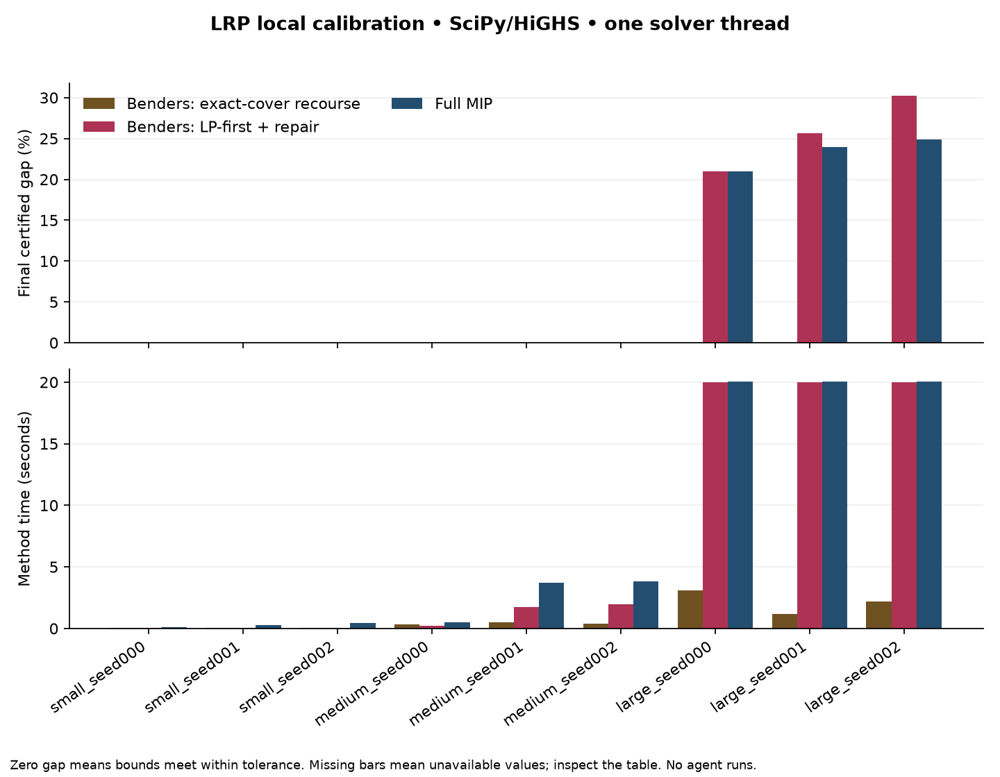

# Local LRP pilot results

These are new SciPy/HiGHS implementations on supplied route pools. They are not Gurobi paper timings, agent results, or unrestricted routing optima.

Each method receives the same input and per-instance budget. Generated instances provide all methods the same feasible witness (recorded externally; no solver warm start). One solver thread is configured. Execution order rotates by instance.

Method time includes input validation, matrix construction, and solves. Process time additionally includes interpreter startup/imports and serialization. Instance generation is reported separately. No time-to-target speedup is inferred from end-of-run timings.

| Method | Runs | Proved optimal within tolerance | Verified feasible outputs | Errors |
| --- | ---: | ---: | ---: | ---: |
| integer_benders_exact_cover | 9 | 9 | 9 | 0 |
| integer_benders_lp_first_repair | 9 | 6 | 9 | 0 |
| monolithic | 9 | 6 | 9 | 0 |

A feasible output may still have a large unresolved optimality gap. The LP-cut variant can stop because no new LP cuts are available; its integer incumbent is not automatically optimal.

| Instance | Method | Objective | Lower bound | Gap | Seconds | Termination |
| --- | --- | ---: | ---: | ---: | ---: | --- |
| large_seed000 | integer_benders_exact_cover | 94.6851 | 94.6851 | 0.00% | 3.1188 | bound_closed |
| large_seed000 | integer_benders_lp_first_repair | 116.5330 | 92.1113 | 20.96% | 20.0103 | integer_recourse_unresolved |
| large_seed000 | monolithic | 116.9803 | 92.4368 | 20.98% | 20.0262 | time_limit |
| large_seed001 | integer_benders_exact_cover | 86.6291 | 86.6291 | 0.00% | 1.1787 | bound_closed |
| large_seed001 | integer_benders_lp_first_repair | 112.4519 | 83.6415 | 25.62% | 20.0104 | integer_recourse_unresolved |
| large_seed001 | monolithic | 110.6235 | 84.1047 | 23.97% | 20.0241 | time_limit |
| large_seed002 | integer_benders_exact_cover | 86.0131 | 86.0131 | 0.00% | 2.1687 | bound_closed |
| large_seed002 | integer_benders_lp_first_repair | 118.7393 | 82.8228 | 30.25% | 20.0099 | integer_recourse_unresolved |
| large_seed002 | monolithic | 110.8759 | 83.2955 | 24.88% | 20.0665 | time_limit |
| medium_seed000 | integer_benders_exact_cover | 39.7145 | 39.7145 | 0.00% | 0.3188 | bound_closed |
| medium_seed000 | integer_benders_lp_first_repair | 39.7145 | 39.7145 | 0.00% | 0.2379 | bound_closed |
| medium_seed000 | monolithic | 39.7145 | 39.7145 | 0.00% | 0.4919 | optimal |
| medium_seed001 | integer_benders_exact_cover | 56.7105 | 56.7105 | 0.00% | 0.5050 | bound_closed |
| medium_seed001 | integer_benders_lp_first_repair | 56.7105 | 56.7105 | 0.00% | 1.7645 | bound_closed |
| medium_seed001 | monolithic | 56.7105 | 56.7105 | 0.00% | 3.6855 | optimal |
| medium_seed002 | integer_benders_exact_cover | 57.5229 | 57.5229 | 0.00% | 0.3801 | bound_closed |
| medium_seed002 | integer_benders_lp_first_repair | 57.5229 | 57.5229 | 0.00% | 1.9517 | bound_closed |
| medium_seed002 | monolithic | 57.5229 | 57.5229 | 0.00% | 3.8337 | optimal |
| small_seed000 | integer_benders_exact_cover | 43.9336 | 43.9336 | 0.00% | 0.0481 | bound_closed |
| small_seed000 | integer_benders_lp_first_repair | 43.9336 | 43.9336 | 0.00% | 0.0613 | bound_closed |
| small_seed000 | monolithic | 43.9336 | 43.9336 | 0.00% | 0.0845 | optimal |
| small_seed001 | integer_benders_exact_cover | 55.9468 | 55.9468 | 0.00% | 0.0517 | bound_closed |
| small_seed001 | integer_benders_lp_first_repair | 55.9468 | 55.9468 | 0.00% | 0.0680 | bound_closed |
| small_seed001 | monolithic | 55.9468 | 55.9468 | 0.00% | 0.2545 | optimal |
| small_seed002 | integer_benders_exact_cover | 52.3885 | 52.3885 | 0.00% | 0.0476 | bound_closed |
| small_seed002 | integer_benders_lp_first_repair | 52.3885 | 52.3885 | 0.00% | 0.0786 | bound_closed |
| small_seed002 | monolithic | 52.3885 | 52.3885 | 0.00% | 0.4417 | optimal |

Cross-method bound contradictions: 0.

Inspect `summary.csv`, the frozen configuration/manifest, and each method directory for decisions, independent verification, cuts, LP/MIP statuses, and bound traces. Sampled pools are deliberately labeled restricted. All numerical optimality claims use a relative bound tolerance of 1e-7.

The integer variant uses generic pointwise integer-recourse cuts. It is an exact finite-pattern strategy when all required solves finish, not a claim of state-of-the-art logic-based Benders performance.

