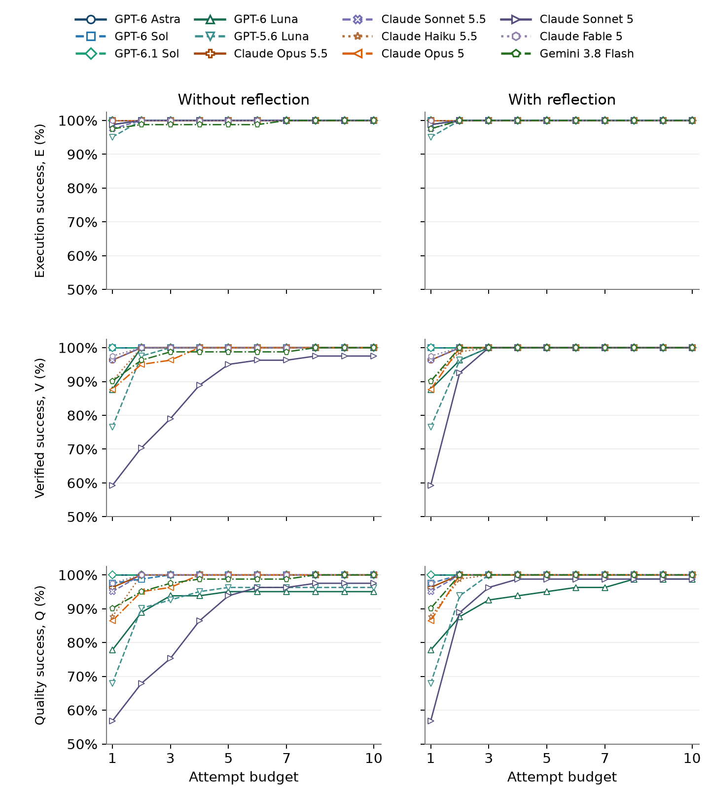
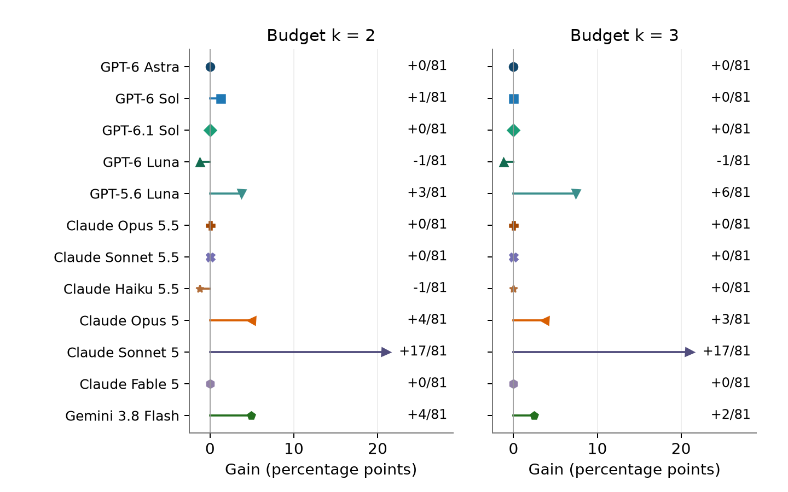
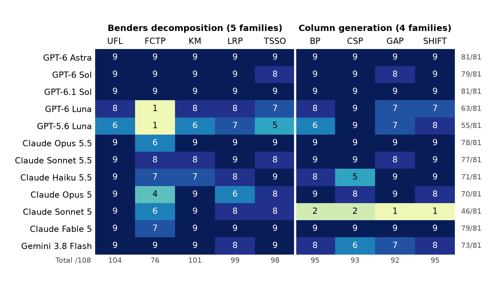
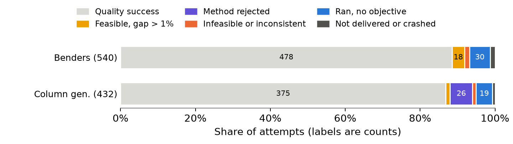
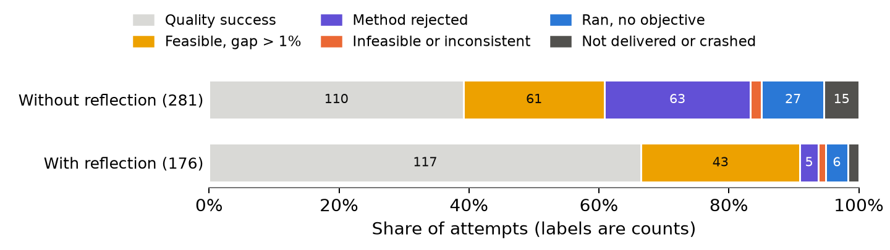
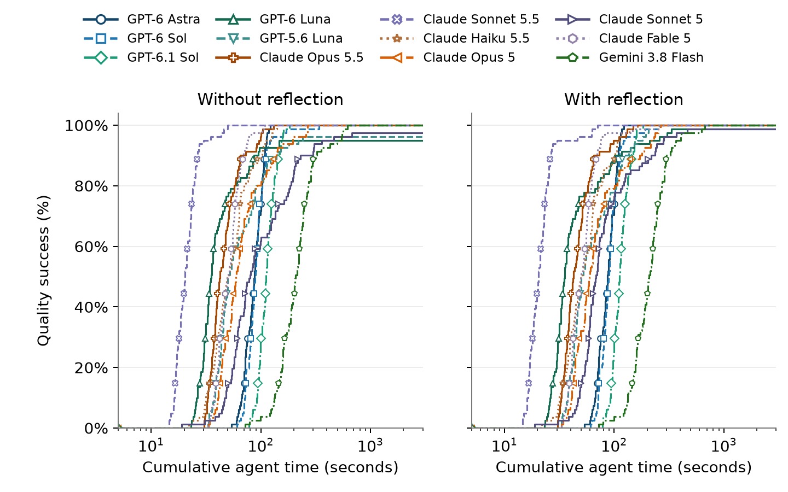
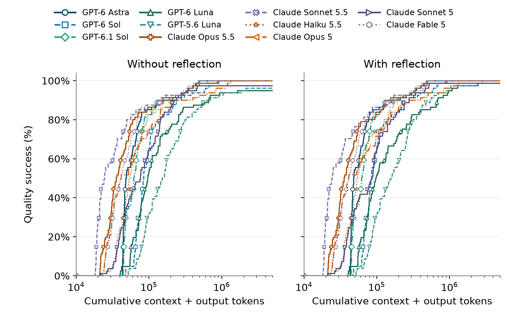
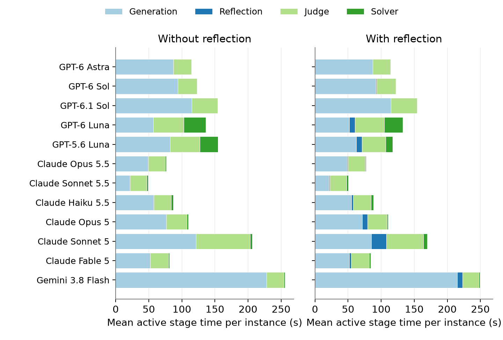

# Paper results

Generated by `python src/03_analysis.py` from the two audited paper campaigns (12 configurations × 81 instances = 972 paired runs). Do not edit by hand.

Q@k is the share of instances with at least one attempt among the first k that runs, passes the feasibility check and the method audit, and is within 1% of the reference objective. P = plain regeneration, R = reflection; the first attempt is shared.

## Quality success

| Configuration | Q@1 | Q@2 P | Q@2 R | Q@3 P | Q@3 R | Q@10 P | Q@10 R |
|---|---:|---:|---:|---:|---:|---:|---:|
| GPT-6 Astra | 100.0% | 100.0% | 100.0% | 100.0% | 100.0% | 100.0% | 100.0% |
| GPT-6 Sol | 97.5% | 98.8% | 100.0% | 100.0% | 100.0% | 100.0% | 100.0% |
| GPT-6.1 Sol | 100.0% | 100.0% | 100.0% | 100.0% | 100.0% | 100.0% | 100.0% |
| GPT-6 Luna | 77.8% | 88.9% | 87.7% | 93.8% | 92.6% | 95.1% | 98.8% |
| GPT-5.6 Luna | 67.9% | 90.1% | 93.8% | 92.6% | 100.0% | 96.3% | 100.0% |
| Claude Opus 5.5 | 96.3% | 100.0% | 100.0% | 100.0% | 100.0% | 100.0% | 100.0% |
| Claude Sonnet 5.5 | 95.1% | 100.0% | 100.0% | 100.0% | 100.0% | 100.0% | 100.0% |
| Claude Haiku 5.5 | 87.7% | 100.0% | 98.8% | 100.0% | 100.0% | 100.0% | 100.0% |
| Claude Opus 5 | 86.4% | 95.1% | 100.0% | 96.3% | 100.0% | 100.0% | 100.0% |
| Claude Sonnet 5 | 56.8% | 67.9% | 88.9% | 75.3% | 96.3% | 97.5% | 98.8% |
| Claude Fable 5 | 97.5% | 100.0% | 100.0% | 100.0% | 100.0% | 100.0% | 100.0% |
| Gemini 3.8 Flash | 90.1% | 95.1% | 100.0% | 97.5% | 100.0% | 100.0% | 100.0% |
| **All (972 pairs)** | **87.8%** | **94.7%** | **97.4%** | **96.3%** | **99.1%** | **99.1%** | **99.8%** |

## Executable, verified and quality successes (counts of 972)

| Criterion | @1 | @2 P | @2 R | @3 P | @3 R | @10 P | @10 R |
|---|---:|---:|---:|---:|---:|---:|---:|
| E: executable | 962 | 971 | 972 | 971 | 972 | 972 | 972 |
| V: verified | 876 | 939 | 959 | 951 | 972 | 970 | 972 |
| Q: quality | 853 | 920 | 947 | 936 | 963 | 963 | 970 |

## Figures

*Quality success Q@k by attempt budget, without (left) and with (right) reflection.*

*The three criteria by attempt budget: executable (E), verified (V) and quality (Q).*

*Additional instances solved with reflection at budgets 2 and 3.*

*First-attempt successes per configuration and problem family.*

*First failed check of each first attempt, by method.*

*First failed check of each retry, by policy.*

*Quality success by cumulative agent time.*

*Quality success by cumulative context + output tokens.*

*Mean active time per instance by stage.*

LaTeX tables are in [tables/](tables/), the prompt examples of the paper appendix in [prompts/](prompts/), and hashes of every input and output in [provenance.json](provenance.json).
